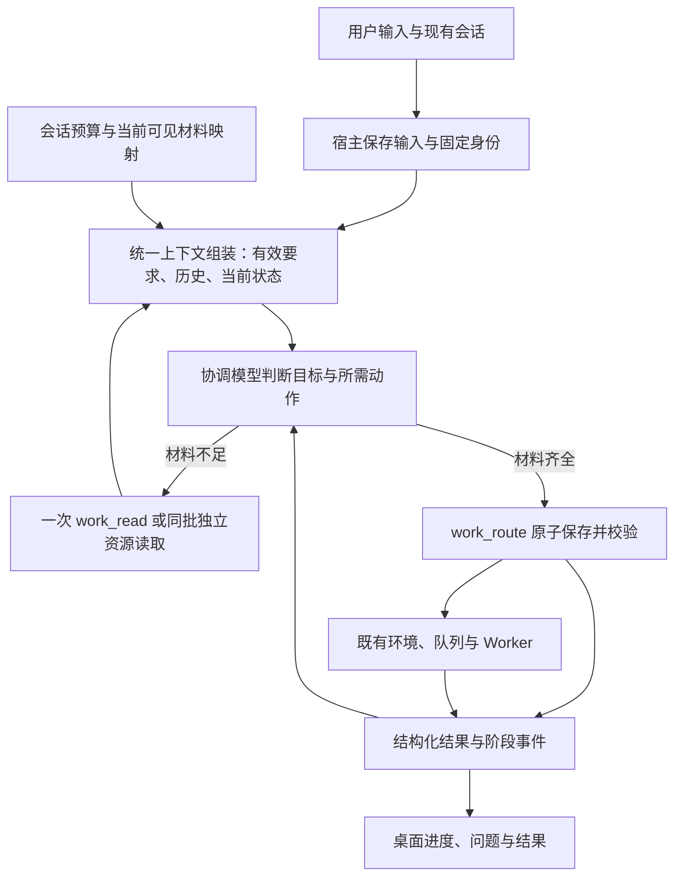

---
{
  "schema": "harness-note/2",
  "id": "4c1eac60-2311-4936-b1c8-2a516c956a8a",
  "kind": "idea",
  "lifecycle": "draft",
  "created": "2026-11-12",
  "updated": "2026-11-12T15:57:19Z",
  "class": "architecture",
  "module": "note://972afef3-2fc7-49de-a3ee-7e041225d28c/95ec5f71-33e3-4f71-aa05-d3e725c33b10",
  "relations": [
    { "type": "related-to", "target": "note://972afef3-2fc7-49de-a3ee-7e041225d28c/61ec1bb4-e349-4aa2-a10b-346afef29920" },
    { "type": "related-to", "target": "note://972afef3-2fc7-49de-a3ee-7e041225d28c/a775d2a2-1aa1-4986-9e20-117882c2b9fb" }
  ]
}
---

# SuperAgent 工具、运行时与上下文统一优化方案

## Intent

本篇保留短请求延迟分析、大窗口参数与工具流程的统一设计及 V1–V10 验收边界。用户已授权 xdo 实施，实现事实归[上下文决策](../superagent-context.md)。Main Agent 直接实现和自查，本次没有独立 Agent 审计或新建 Task；下文设计不表示每项云模型性能指标均已验收。

目标是让协调器在材料足够时直接决策，在材料不足时一次取得必要信息，使用现有引擎完成派发、排队和恢复。以用户常用的 1M 级模型为主要场景，运行时仍使用当前端点的 effectiveContextWindow 和实际输出额度。现有 chat-model-budget 已解析模型容量；旧 SuperAgent 的 8000-token 业务投影上限已移除。大窗口提供空间，减少模型往返才是本次主要优化方向。

## Review 结论与证据边界

本机安装版 0.9.9、引擎 20c26913ba5c4f38 的目标请求耗时 239.665 秒；15 次工具合计 13.820 秒，其中 10 次 work_read_resource 合计 5.906 秒，首次正文在第 234.862 秒。工具之外的时间包含模型、网络和宿主处理。记录缺少资源 ID、offset 实值、路由阻塞正文及完整模型请求数，不能把十次读取都认定为重复，也不能把其余时间都称为推理。原始统计、安装字节核对与探针证据归[少轮派发分析](superagent-harness-reliability.md#协调器上下文与少轮派发codex-cli-参考待实施)。

| 优先级 | 已确认机制或设计缺口 | 审查结论 |
| --- | --- | --- |
| P0 | 工作卡优先 assignment，路由从旧 interpretation 取 coveredInputIds | 统一读取入口；只换来源还不够，必须修正覆盖含义 |
| P0 | 卡片将来源输入、assignment.inputId 和 backgroundInputIds 合并为 coveredInputIds | 背景不自动证明纳入有效说明；新结构显式记录覆盖，旧记录保持未知 |
| P0 | ContextReadEvidence 每轮新建，普通历史正文不自动取得读取凭据 | 基于实际模型请求维护来源映射，取消必须经过读取工具的隐性要求 |
| P1 | 8000 tokens、100／120 tokens 预览、1200 字符切片和多层比例叠加 | 必要材料按共享预算完整交付；预览只用于可选目录和历史 |
| P1 | 卡片同时携带 work.assignment 与 intent 切片，已读判断只看 intent 的截断标记；缩减行数后没有最终预算拒绝 | 派发视图只保留一份规范正文；完整性按实际内容清单判断，完整序列化结果仍须通过总预算校验 |
| P1 | 提示词规定目录→卡片→原文，工具工厂全部 sequential | 工具能力与提示词一起调整；现有循环已经支持同批调用，串行标记不等于每次都要模型往返 |
| P1 | readBudget 在请求前计算，每个资源读取可独占一份余量 | 并行前必须加入批次共享预算和确定的返回顺序 |
| P1 | 路由将最新报告摘要被截断直接加入必读集合 | 按当前决定的实际依赖读取；回答报告、完成判断和依赖报告的修改不能省略 |
| P1 | blocked、版本冲突和部分异常的返回形状不同 | 在现有动作／调度记录上统一结果与恢复条件，避免新增状态存储 |
| P2 | 大窗口仍经最多 6000 tokens 分块、最多 2000 tokens 摘要串行压缩 | 是代码可见的潜在瓶颈，未证明本次发生；单独回放后决定改造 |

现有 agent-core 的批量执行、变更屏障、取消配对，以及已实现的长命令续接均继续复用。已有调度、环境和停止修复不能再次列为未实施缺陷。当前工程边界保持：协调器理解、关联和分派；工程调查、修改和验证由 Worker 执行。独立工作的报告不新增自动返修，多 Worker 工作流沿用原有明确授权和依赖规则。

## 目标架构与职责

这是一组现有模块的职责收敛，不引入第二个协调 Agent、记忆 Agent、调度器或账本。janus-agent/superagent 拥有业务依赖和派发事务；chat-core 拥有会话预算、历史、压缩及当前请求的内容清单；agent-core 拥有工具执行与取消。JanusX 提供模型、持久化和环境端口，负责呈现。原生 Worker 管理自己的会话窗口，协调器的容量不能覆盖其 MCP 输出限制。

## 工具设计

### 保留少量明确入口

| 工具 | 优化后职责及触发条件 |
| --- | --- |
| work_list | 目标不明时搜索／分页；明确绑定工作不强制先列目录 |
| work_read | 默认返回派发所需完整材料；历史和审查视图按需展开，复用现有工具，不新增 prepare／inspect／hydrate 三层入口 |
| work_read_resource | 精确读取必要原文、旧报告与大材料；按版本分页，独立资源允许同批调用 |
| work_route | 新建、继续和控制的业务事务；保存完整有效说明与当前输入后安排执行，返回真实结果 |
| work_environment | 新环境选择、Git 发布目标或环境纠错时检查；普通续接由宿主复核已分配环境 |
| work_update_context | 仅保留未派发旧记录兼容；新流程统一通过 work_route 保存说明，移出正常模型指引的推荐路径 |
| work_git、工作流工具 | 保持既有明确职责、授权与能力边界，复用统一结果投影，不增加自主操作范围 |

work_read 的派发视图返回工作身份与当前修订、完整有效目标和约束、未纳入的新输入原文、已分配环境与当前状态，以及具体缺口和续读引用。同一目标／约束只保留一份规范正文，不同时复制原 assignment 和多套摘要。已在当前请求中完整可见的同版本正文可以只给引用。旧执行流水和无关报告默认不展开；报告是当前问题、完成判断或指代对象时，纳入所需材料。历史分页字段为兼容保留，普通续接不要求模型手动遍历多组 offset。

工具 schema 保持简短和稳定，兼容当前供应商的平面参数表示；不在每个模型请求中随状态反复切换整套工具定义。说明围绕何时使用、返回什么和副作用展开；固定提示只保留语义原则，约束校验由宿主负责。只读并行只改变调度能力，不扩大访问权限。

### 成功路径与恢复路径

已知工作且材料齐全时可直接 work_route；需要加载工作时为 work_read → 模型形成决定 → work_route；目标不明确才加入 work_list。新工作在完整当前请求和必要环境信息足够时也可直接路由。停止／关闭沿用控制通路，不以补读历史为前置。目标调用数用于回放验收，不是所有任务的调用上限。

work_route 不自动补全语义再执行。发生材料缺口时，首期返回结构化缺口及建议的 work_read 参数；统一派发视图已承担聚合读取。后续只有回放证明仍有收益，才考虑让阻塞回执直接附上预算内缺失正文；正文必须进入下一次模型请求，再由模型重新决策，不由宿主重放原路由意图。这消除了前版同时维护两条聚合读取路径的歧义。

## 上下文机制

### 分开维护原文、有效说明和当前可见材料

| 层次 | 负责内容 | 不能推导的结论 |
| --- | --- | --- |
| 持久原文与执行记录 | 用户输入、报告、动作、投递及资源版本，保留追溯 | 已保存、已交付不代表已理解或已完成 |
| 当前有效说明 | 目标、仍有效约束、来源及明确纳入的输入版本，由模型形成并随派发保存 | 背景引用不自动变成覆盖；不覆盖用户的新要求 |
| 当前模型请求 | 历史、压缩结果、有效说明、工具正文和对应来源映射 | 过去读过不代表现在还在窗口中；摘要不冒充完整原文 |

增加共享的有效上下文解析入口供工作卡、路由和 Worker 使用。assignment 为新记录的主来源，legacy interpretation 为明确兼容来源；扩展 assignment 的来源／覆盖表达，保留当前 inputId、backgroundInputIds 和 revision 的原有含义。模型声明本次说明吸收了哪些输入版本，宿主核验来源存在、范围合法及必要材料确实暴露，不声称程序证明了语义理解。被用户明确替换的约束从当前说明退出，原文继续保存；冲突和指代不明保持为缺口。

旧 assignment 没有显式覆盖字段时标为未知，不从 backgroundInputIds、delivered 或 availableInputIds 批量推断。首次相关续接时，一次返回所需短原文，由模型形成完整说明并声明来源，随新动作提交；只读查询不偷偷迁移。不能因为当前修订较新，就忽略未纳入的旧输入或新变化。

当前有效说明可以承接历史要求，派发不要求每次重读全部历史。原文仍是争议、精确措辞、报告依赖和说明缺失时的恢复来源。Worker 接收完整有效说明、本次新指令和必要原文引用；背景不额外创建 delivery，不使历史请求重新获得执行授权。

### 一个会话预算

由 ManagedChatSession 统一拥有模型窗口、固定指令和工具 schema 占用、实际请求输出预留、token 估算余量与压缩策略。预算来自最终模型请求的同一快照，包含历史、工具封装和待加入的结果；SuperAgent 不再独立计算窗口比例。先保障当前完整输入、当前有效要求、相关历史及尚未纳入的变化，再分配目录和可选资料。超长且不能容纳的必要原文保持可恢复缺口，不宣称已经完整交付。

同一内容仅在实际保留的位置计入预算，不以引用为由漏算仍在历史里的副本。完整材料不再为了填满窗口重复注入；明确绑定工作才加载其必要状态，不通过最近记录或关键词自动选择执行目标。1M 是可用容量，不是每次请求必须填充的目标。

| 当前参数或策略 | 推荐处理 |
| --- | --- |
| INLINE_CONTEXT_TOKENS=8000 | 删除 SuperAgent 独立上限，使用会话剩余预算 |
| 协调器重复注入最近 4 轮 | 移除固定轮数的重复投影，复用会话历史及来源映射；Worker 的背景选择按独立职责维护 |
| INITIAL_WORK_CANDIDATES=5 | 按目录实际大小与剩余预算返回，溢出保留查询／续页；UI 首屏分页可独立保留 |
| 必要原文 100／120 tokens 预览 | 删除固定小预览；能放下的原文完整交付，超出真实预算才分页 |
| 必要目标／约束 1200 字符切片 | 在派发投影中取消；UI 摘要与历史浏览仍可使用独立展示策略 |
| SuperAgent 容量比例、Inline 分摊及重复预留 | 移除业务层重复计算，使用会话预算；通用压缩器的触发与回落水位集中保留，并经实测调整 |
| 所有读端统一 48000 字符上限 | 改为读端实际输出／传输能力与共享预算的交集；本地工具不继承原生 MCP 的小上限 |
| Worker MCP 字节限制及原生输出限制 | 保留并按实测契约计算；协调模型 1M 不代表原生工具输出无上限 |

分页、UI 摘要、语法校验上限与模型容量属于不同职责，不一并删除。合法 ID 长度、资源大小、原生传输边界、运行取消和应急保护继续存在。不新增“最多读 N 次”或“低于某个置信度不得派发”的业务阈值，也不把散落常量搬成新的用户设置。

### 可见性与版本

宿主在最终模型请求组装完成后，按可信消息／资源身份、哈希版本和实际范围登记正文暴露，覆盖普通历史、直接注入和工具结果。模型生成的引用文字、未发出的预览和未暴露的工具结果不能登记。去重、裁剪、压缩、steering 和供应商适配完成后重新校验，防止“登记完整、实际截断”。该映射由实际历史重建，不要求每轮重新调用工具，也不永久保留旧随机 receipt。

同批独立读取可以并行，依赖这些新正文的派发必须经过下一次模型请求。压缩、回滚、分叉、模型切换或资源变化时重算当前映射；取消、旧分支和跨对话内容不能串用授权。模型窗口缩小时，在发送前重新预算和恢复必要说明。

用现有 assignment revision 和资源 hash 判断正文是否改变，不能因无关排队状态变化就使全部正文失效。派发仍在事务提交处检查当前 work revision、执行身份和环境；版本冲突返回新的状态／变化及所需修订，由模型重新判断。首期保留现有并发控制，不为减少读取另造一套全局 revision 或放松事务检查。

### 稳定历史与按需压缩

复用既有历史和 checkpoint，固定规则与工具 schema 顺序稳定，工作变化追加为带身份和版本的观察。历史资料保持原有来源和信任级别，报告、日志或外部文本不提升为系统指令。协调器内容和 Worker 内容分别按真实接收端的预算与能力投影。

压缩只由统一会话压力触发，保护当前输入、有效约束、未完成问题、派发身份及完整工具调用／结果配对；压缩结果是带来源的背景，不能自动提升为完整原文证据。保留现有压缩失败不丢原文的行为。大窗口压测单独检查 6000／2000 的串行路径；若成为瓶颈，在摘要请求自身的真实预算内扩大批次、减少串行总结，不能并行合并后丢掉约束替换顺序，也不假设摘要模型和协调模型容量相同。

## 底层执行与结果契约

### 复用执行循环和共享批次预算

沿用 runJanusAgentLoop 的连续 parallel 分组、变更屏障与工具结果配对。只读 work_list、work_read、work_read_resource、work_environment 和 workflow_read 在依赖允许时声明并行；派发、上下文写入和控制保持顺序及原子性。并行读取绑定一致快照或各自准确修订，结果仍按调用身份和确定顺序返回；一个结果失败不使其他结果失去配对。

批次在执行前按必要性和调用顺序分配总输出预算，不让每个调用读取全部剩余空间。最终 JSON 封装和引用元数据也计入，失败／取消的预留及时释放；不足时返回明确剩余范围或预算压力，由会话统一压缩／续读。不要先产生若干完整输出，再静默砍掉末尾结果。只改 executionMode 主要降低工具墙钟时间；是否减少模型请求次数由工具返回内容和模型行为共同决定。

现有长命令的 running 回执、executionId、自动等待和同 callId 完成更新继续使用。前台 yield 与实际执行期限分别表达；不因前台等待结束而重启命令，不要求模型定时重复查询来等结果。此项已实施，是集成回归义务，不是本轮重新造的功能。

### 一个事实来源，多种结果投影

在已有 action、delivery、schedule 和 execution 上生成统一结果视图，不新增另一份工作状态账本。视图至少包括请求／工作／输入／执行身份、当前修订、阶段与结果、稳定原因码、必要引用、已确认或未知的副作用，以及当前允许的下一步。读取工具、派发工具和桌面消费同一事实；下面是待实现的语义分类，不要求另造一套同名持久枚举。

| 结果 | 模型和界面的行为 |
| --- | --- |
| 材料不足、预算压力 | 显示具体缺口和聚合读取入口；已有完整材料不重复读 |
| 版本变化 | 返回当前状态与差异，重新判断；不自动重放旧决定 |
| 已保存／已排队／已启动／等待回答 | 准确呈现当前阶段；派发成功即可回复安排，不等待开发完成 |
| 确定失败或取消 | 说明已发生动作和恢复条件；取消／拒绝不触发自动重试 |
| 外部结果未知 | 保留动作身份，先核对进程／投递证据，不再次创建或发送 |

work_route 在已有事务内同时保存完整说明、来源和当前输入，再进入环境准备及调度；相同请求身份返回已有结果，内容冲突拒绝。环境授权、Git 具体批准、租约、容量和原生问题按原契约处理。普通续接的环境复核应由宿主完成，不能因为减少模型调用而跳过真实身份检查。

### 进展、取消与用户可见反馈

复用现有循环策略。必要时将新资源范围、有效说明修订、缺口减少、动作阶段变化接入进展判断；不把工具返回成功或“读了另一个 ID”直接等同于推进，也不把无文件修改视为停滞。重复无变化读取返回原有结果与原因，失去上下文后的合法重读仍允许。取消、真实资源保护和应急轮次边界集中在引擎，不能再靠新的每工具次数上限修补流程。

新输入沿既有 steering 路径保存和参与当前轮；状态变化使旧决定失效时重新决策，旧回调不能覆盖新动作。用户停止要传到模型、工具和进程取消边界，未确认停止仍保留占用。重启恢复记录而不自动重放执行。

桌面复用现有事件流显示已接收、读取材料、压缩、派发、排队或等待条件。阶段来自真实事件，不能用固定动画或虚构百分比表示进度；避免每页读取都生成一条模型解释。首条进度和最终回答分别计时，不能用提前发一句话掩盖派发仍慢的问题。

## Codex CLI 参考与取舍

固定参考仍是 openai/codex 的 c0cc9fc820f62e4dbdde68214dd6d792d6c8a7ee；本机只读 checkout 和源码路径归[分析记录](superagent-harness-reliability.md#固定源码与可借用机制)。借用的是独立工具同批执行、写入屏障、持久历史与模型历史分离、稳定前缀、按容量压缩，以及 thread／turn／item 的事件组织。官方[工具指南](https://developers.openai.com/cookbook/examples/gpt-5/codex_prompting_guide#parallel-tool-calling)、[缓存说明](https://developers.openai.com/cookbook/examples/prompt_caching_201)和[App Server](https://learn.chatgpt.com/docs/app-server)分别支持这些方向。

Codex 本身也有工具输出、缓存、进程、等待和压缩阈值；没有证据说其参数总量更少。不照抄其固定 10k 输出或 OpenAI 专用压缩／连接机制到其他供应商，不把 Codex 的工程执行工具直接开放给协调器。模型容量变大也不意味着需要向量库、独立记忆 Agent、额外规划模型或第二套状态机。

## 实施顺序与代码归属

| 阶段 | 具体交付 | 进入下一阶段的条件 |
| --- | --- | --- |
| S0：建立基线 | 保存可重放的脱敏会话快照；补足资源范围、路由缺口和模型请求跨度诊断 | 能区分模型往返、工具执行、宿主准备、排队和压缩时间 |
| S1：上下文正确性 | 统一 assignment／legacy 解析，显式覆盖兼容，最终请求可见性映射，修正报告依赖及版本刷新 | 新旧记录、已在历史中的正文、背景不等于覆盖、同批读派发测试通过 |
| S2：预算与工具收敛 | 统一会话预算、完整必要材料、work_read 派发视图、简化提示词、批次预留和只读并行 | 1M 与小窗口均不越界；短补充走直接派发或一次读取后派发 |
| S3：运行反馈与集成 | 统一结果投影、稳定追加上下文、桌面阶段事件、固定引擎包接入；按基线决定压缩器调整 | 取消、恢复、幂等和实际桌面路径通过，旧／新轨迹可比较 |

S1 与 S2 在同一功能切片内交付，避免只放宽已读门槛却没有完整材料。代码主改动位于 agentX 的 janus-agent/src/superagent/chat-tools、context、context-reader、schema／contracts 及相关派发服务；预算与请求映射位于 chat-core 的 managed-chat-session 和组装接口。agent-core 仅补需要的批次预留、事件和执行元数据接缝，复用现有循环。JanusX 的 chat-orchestrator、模型预算端口和事件 UI 接入结果，容量解析继续沿用原实现。

通过固定构建包交付消费端，不直接修改 node_modules。兼容字段采用可缺省的新表达，旧正文、动作身份和回执不重写；旧覆盖未知时显式恢复。回滚需保留新来源字段和已保存输入，不能回滚或重放外部执行。记录构建包／安装包版本，避免把源码验证误称为运行应用已修复。

## 验收与观测

| 编号 | 场景 | 必须满足的结果 |
| --- | --- | --- |
| V1 | 已知工作的短补充，必要材料已可见 | 零次单资源补读，可直接路由；需要工作卡时一次 work_read 后路由 |
| V2 | 目标不明、新工作、停止和历史询问 | 必要时查目录／澄清；停止不等待历史；历史查询不启动执行 |
| V3 | 1M 模型下必要材料超过旧 8000 tokens | 能容纳则完整交付，不因旧常量再次补读；实际请求不超窗口 |
| V4 | 小窗口、长原文、模型切换、原生 MCP | 正确分页或压缩，范围与实际正文一致；保留续读，不能静默丢要求 |
| V5 | 旧 assignment、背景引用、未纳入输入、旧约束替换 | 不虚构覆盖；完整形成当前说明；Worker 收到有效约束和短句指代 |
| V6 | 多个独立读取、部分失败、读和派发同批 | 批次总预算有效、结果完整配对；未进入模型的新结果不能授权派发 |
| V7 | 压缩、分叉、回滚、steering、正文或状态版本变化 | 映射不串线，必要时恢复；无关状态变化不要求全部重读，旧动作仍被版本校验拒绝 |
| V8 | 重复请求、取消、未知回执、崩溃恢复 | 不重复创建或投递；取消结果不重试；未确认停止继续占用 |
| V9 | 问题报告、普通补充和完成判断 | 只补读本决定依赖的报告；旧 ready 不覆盖当前失败，不以交付代替验收 |
| V10 | 长命令、环境准备、排队和桌面呈现 | 复用续接与阶段事件，不重启命令；模型、聊天和侧栏对同一事实一致 |

先用确定性 fixture、真实本地子进程及模拟 Worker 回执验证协议与副作用，再用同模型、同会话快照、同任务集合比较旧／新行为。回放不重复实际派发用户任务。性能比较使用多次样本，记录样本数、中位数及长尾，不以单次模型输出判定改善。

每个请求关联 conversation／turn／modelRequest／toolCall／work／action 身份，记录最终输入 tokens、缓存 tokens（供应商不提供则未知）、输出 tokens、模型首事件和结束、工具排队与运行、压缩、派发阶段，以及 required resource 的 ID／version／range、补读原因和前后缺口。耗时按跨度处理并行重叠，不能用工具耗时简单相加推导模型时间。默认诊断保存元数据与必要脱敏证据，不复制完整用户会话正文。

性能验收同时检查模型请求数、资源调用数、首事件／首正文时间、派发时间和 Worker 实际收到的要求。固定目标场景中去掉无谓补读和阻塞；复杂任务保留合理查询，不设置所有任务的两次工具硬上限，也不承诺未经测量的秒数或倍率。

## Open questions

dispatchContextSchema 已兼容扩展 coveredInputs，旧记录缺省保持未知。可见性观测在主会话 streamTextFn 入口重建，压缩摘要不能作为原文证据；原生 Worker 仍按自身 MCP 输出契约保护。不同供应商的最终线协议可能继续转换消息，目前的本地协议验证不能声称覆盖所有供应商。

不同供应商的 token 估算误差、缓存收益、真实云模型语义质量与多样本延迟仍需后续测量。没有引入评分器或自动调参，也没有重放真实用户派发。context_diagnostic 与既有用量／timeline 事件提供可关联元数据，供应商未提供的缓存和排队耗时保持未知。

## Implementation and verification

2026-11-12 用户授权 xdo 后，Main Agent 在 janus-agentX 实现并向 JanusX 交付固定六包构建 `6312b33e4d9530717e4964cc8fd6440be26a74c17ffc96c921c97ec36a6e70b2`。消费端 package.json、lock 与 vendor manifest 一致，通过安装字节校验；未直接修改 node_modules。原始消费端基线为 `5b830e07d355e7ea`，运行安装版的旧引擎仍为独立事实。实现归[上下文决策](../superagent-context.md)，本篇保留设计及原验收范围。

S1–S3 的代码已经接入：显式版本覆盖、共享 effective 解析、跨轮可见证据重建、当前输入在压缩前适配真实窗口、聚合派发卡、只读并行和批次预算、未知副作用恢复回执及脱敏 timeline 诊断。工具 schema 占用复用会话组装时的 JSON Schema 估算，不能把 Zod 内部对象的序列化大小当成实际工具成本。Worker 历史卡也按剩余预算填充短原文，避免计入元数据后旧 120-token 预览变成空正文。未添加读取次数限制、第二套账本或额外记忆模型。

已完成的分组验证如下，数量不是互不重叠的整仓总计：

| 范围 | 命令／证据 | 结果 |
| --- | --- | --- |
| agent-core 批次与屏障 | `npm test --workspace @janus-agent/agent-core`；引擎 artifacts/context-core-tests.log | 392 passed，1 既有 skip |
| chat-core 预算及压缩 | `npm test --workspace @janus-agent/chat-core`；引擎 artifacts/context-chat-tests-final.log | 68 passed |
| janus-agent 上下文与运行 | `npm test --workspace @janus-agent/janus-agent`；引擎 artifacts/context-agent-tests-final.log | 225 passed |
| 消费端上下文、MCP、生命周期、时间线、命令续接与归档 | 指定文件的 `npm run test:unit:fast -- ...`；artifacts/superagent-context-unit-final.log | 61 passed；最终固定包 4 文件 21 项复跑通过 |
| 真实 Git、路由、受管 Worker | `npm run test:integration -- tests/unit/superagent-routing.test.ts tests/unit/superagent-context-environment.test.ts tests/unit/superagent-workers.test.ts`；artifacts/superagent-context-integration-final.log | 33 passed |
| 发布边界与类型 | `npm run typecheck:strict-unused`、`npm run prepackage`、`npm run check:package-boundary` | 通过 |
| 构建与静态检查 | `npm run build:check`、定向 ESLint | 通过；产物在 artifacts/build-check |
| 文档 | 消费端 `npm run check:notes`；引擎 `node scripts/verify-note-corpus.mjs` | 343／74 篇均 0 errors，保留 17／16 条读取或外链诊断 |
| Electron 上下文与派发 | `npx playwright test --config playwright.desktop.config.ts tests/e2e/desktop-superagent.spec.ts -g 'context budget'` | 最终构建 1 passed，覆盖继续／停止／重启恢复 |
| 原生 MCP 原文与生命周期 | `npm run test:integration -- tests/unit/superagent-native.test.ts --maxWorkers=1` | 最终包 1 passed，真实 Codex 与本地模型 fixture |

1M 窗口固定压缩 fixture 从 21 次摘要调用降到 1 次；这只证明消除了固定小分块，不是生产耗时倍率。Electron 旧综合用例已观察到长原文两次模型请求、一次 work_route、零次单资源补读和原生 Worker 写入汇报，但随后在通知跳转草稿恢复断言失败。该断言保留，未把整条旧 UI 用例标为通过；本次上下文、继续／停止及重启链路另设独立回归，结果在上下文决策记录。

S0 保留了改动前统计和本地协议轨迹，并新增来源范围／预算诊断；原日志缺失的完整请求与资源参数不能追补成真实旧会话快照。未完成同一云模型的多样本新旧回放，不承诺线上延迟。应用构建使用 artifacts/build-check，未替换已安装桌面或用户当前执行。整个仓库 verify 与独立 Agent 审计未运行。
