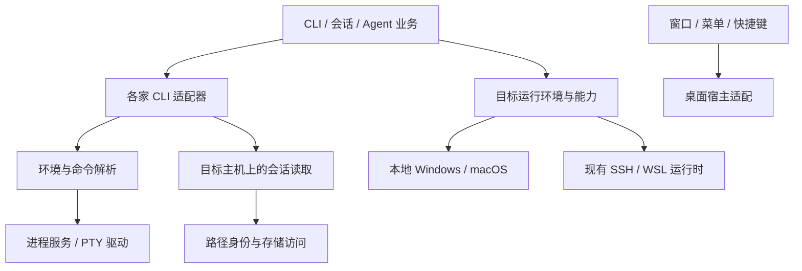

---
{
  "schema": "harness-note/2",
  "id": "c2c09ecc-91cc-4fa8-a624-cfa56f47e0a6",
  "kind": "note",
  "lifecycle": "draft",
  "created": "2026-11-14",
  "updated": "2026-11-14T17:40:42.058Z",
  "class": "architecture",
  "tags": [
    "cross-platform",
    "runtime",
    "orca",
    "macos"
  ],
  "module": "note://972afef3-2fc7-49de-a3ee-7e041225d28c/3a4dc304-70dd-49e4-b46a-ee2fc0fbc83e",
  "relations": [
    {
      "type": "related-to",
      "target": "note://972afef3-2fc7-49de-a3ee-7e041225d28c/5b300170-6b75-400d-998e-1d699dd7d591"
    },
    {
      "type": "related-to",
      "target": "note://972afef3-2fc7-49de-a3ee-7e041225d28c/740aaee0-02b5-40e3-85ec-11088db634a1"
    },
    {
      "type": "related-to",
      "target": "note://972afef3-2fc7-49de-a3ee-7e041225d28c/bc53c6cc-29fb-59db-a0cf-1e32eaf2fc0a"
    }
  ],
  "codeRefs": [
    {
      "repoId": "972afef3-2fc7-49de-a3ee-7e041225d28c",
      "path": "src/shared/workspace-runtime.ts",
      "role": "implementation"
    },
    {
      "repoId": "972afef3-2fc7-49de-a3ee-7e041225d28c",
      "path": "src/main/workspace/runtime.ts",
      "role": "implementation"
    },
    {
      "repoId": "972afef3-2fc7-49de-a3ee-7e041225d28c",
      "path": "src/main/external-cli/service.ts",
      "role": "implementation"
    },
    {
      "repoId": "972afef3-2fc7-49de-a3ee-7e041225d28c",
      "path": "src/main/terminal/manager.ts",
      "role": "implementation"
    },
    {
      "repoId": "972afef3-2fc7-49de-a3ee-7e041225d28c",
      "path": "src/main/shutdown/process-tree.ts",
      "role": "implementation"
    },
    {
      "repoId": "972afef3-2fc7-49de-a3ee-7e041225d28c",
      "path": "src/main/sessions/session-registry.ts",
      "role": "implementation"
    },
    {
      "repoId": "972afef3-2fc7-49de-a3ee-7e041225d28c",
      "path": "src/main/platform/process-host/core.ts",
      "role": "implementation"
    },
    {
      "repoId": "972afef3-2fc7-49de-a3ee-7e041225d28c",
      "path": "src/main/platform/runtime-context.ts",
      "role": "implementation"
    },
    {
      "repoId": "972afef3-2fc7-49de-a3ee-7e041225d28c",
      "path": "src/main/external-cli/provider-paths.ts",
      "role": "implementation"
    },
    {
      "repoId": "972afef3-2fc7-49de-a3ee-7e041225d28c",
      "path": "src/shared/runtime/path-identity.ts",
      "role": "implementation"
    },
    {
      "repoId": "972afef3-2fc7-49de-a3ee-7e041225d28c",
      "path": "src/shared/runtime/capabilities.ts",
      "role": "implementation"
    },
    {
      "repoId": "972afef3-2fc7-49de-a3ee-7e041225d28c",
      "path": "scripts/check-runtime-boundaries.mjs",
      "role": "test"
    },
    {
      "repoId": "972afef3-2fc7-49de-a3ee-7e041225d28c",
      "path": "scripts/check-macos-resources.mjs",
      "role": "test"
    },
    {
      "repoId": "972afef3-2fc7-49de-a3ee-7e041225d28c",
      "path": ".github/workflows/runtime-platform.yml",
      "role": "implementation"
    }
  ]
}
---

# 跨平台运行时边界、Orca 参考与实施计划

## 目标与状态

用户要求 Windows/macOS 差异集中维护，避免每新增一个 JanusX 功能就重复写平台适配。建议在现有模块上建立可执行的调用边界：业务调用统一服务，环境、进程、PTY 和路径语义在各自基础模块收口，各家 CLI 的安装规则与会话格式由 provider 适配器拥有。桌面窗口、快捷键、系统集成及发行包仍需要平台实现。

本文维护源码调查、详细实施计划与当前证据。Orca 固定为 `0655604bf6c299a89c05977b3f9c7aaf8b645e03`，通过 Git 提交树和该提交的原始文件核对；没有构建或运行 Orca。JanusX 从 HEAD `453e0872d12e1597a340c113d526c73940302d40` 的当前工作区开始，保留此前 CLI 修复与其他未提交改动。用户已确认按 P0→P7 顺序执行；P0—P5 源码迁移完成，P6—P7 的可用 Windows 检查、Mac 模拟与资源门禁已执行。完整 verify 尚非全绿，真实 Mac／远端及 Mac 发行验收仍未完成，不能把阶段执行结束等同于发行通过。xdo 由主 Agent 直接执行，未创建 Task。现有实测证据与 Mac not-run 项继续由 [macOS 兼容性](./macos-compatibility.md)及[CLI／会话专项](../terminal/macos-cli-sessions.md)拥有。

## Orca 的实际工程边界

Orca 并没有消灭 `process.platform`，也不是一个覆盖所有能力的 `PlatformService`。它将高复用机制收口，再通过检查脚本和目标系统测试约束调用方；遗留分支和直接调用仍存在。

| 边界 | 固定提交中的实现 | 对 JanusX 的启示 |
| --- | --- | --- |
| 普通子进程 | 独立 `@orca/process-host` 包处理 spawn/fork、输出上限、超时、取消、Windows 参数与进程树回收；不依赖 Electron、原生 addon 或运行时 npm 依赖。桌面、CLI、daemon 和 relay 可复用同一实现。[包说明][O1]、[ProcessSpec][O2] | 检测、安装、登录、工具执行共用进程服务，保留结构化 program/args/env/cwd，避免各入口拼 shell 命令 |
| Windows 启动细节 | `resolveSpawn(spec, platform)` 固定 `windowsHide: true`、`shell: false`；识别 npm 等 `.cmd` shim 时解析实际目标，其他 `.cmd/.bat` 才走集中编码的 cmd 路径。[源码][O3] | 把既有 shim 解析和退出确认收口，不能仅给所有调用加 `shell: true` |
| GUI 启动环境 | 启动阶段有独立 shell 环境模块；探测登录 shell PATH，处理标记、超时、缓存和强制刷新；区分 Windows Path 大小写与 POSIX 路径顺序。Mac 无 SHELL 时默认 `/bin/zsh`。[源码][O4] | 环境形成后供检测、安装与启动共同使用；安装或 shell 配置变化需要明确失效机制 |
| 执行位置 | `ExecutionHostId` 区分 local、SSH、runtime；会话扫描按 environment 路由 RPC，返回记录附执行主机身份与 pairing revision。[身份][O5]、[会话扫描][O6] | 桌面宿主系统不等于命令执行系统；远端会话应在拥有文件的主机扫描，不能拿本机 HOME 代替远端 HOME |
| CLI 差异 | `TuiAgentConfig` 声明检测别名、必需命令、不可用 runtime、平台启动命令、prompt 注入与就绪信号。[配置类型][O7] | provider 行为集中配置或策略化；这不意味着安装后处理、认证和历史格式可以全变成一张静态表 |
| 路径身份 | 比较函数区分 Windows drive/UNC 与 POSIX；保留 POSIX 大小写，处理 WSL UNC 别名及 Unicode NFC。比较 key 与真实路径用途分离。[源码][O8] | 修复会话 scope 时集中定义身份语义，不能所有路径都 `toLowerCase()`；也不能机械改写真实文件名 |
| PTY 与普通进程 | PTY 所有者明确区分 `posix-pty`、`windows-conpty`、`windows-wsl`，依据实际 shell 和平台决定。[源码][O9] | 公用启动描述可以复用，PTY 输入输出、resize、退出、原生资源仍由终端驱动负责，不能强塞进普通 spawn |
| 防止重新扩散 | `check-process-host-imports` 验证公开导出、依赖边界及业务层直接 `child_process` 导入；新增直接导入失败，旧基线减少后要求删除旧条目。PR preflight 接入边界检查。[检查脚本][O10]、[PR][O11] | 需要“新增违规不允许、旧调用逐步减少”的门禁，单靠团队约定不足以守住统一入口 |
| 原生与分发 | electron-builder 集中平台资源、原生运行时和打包后验证；Mac 声明最低系统版本、entitlements、签名／公证及专用 terminal host。[配置][O12] | 代码能跑和发行包可用分别验收；不能把打包、系统权限和更新问题藏进业务层 |

测试配置也按边界划分：PR Windows job 包含真实 Windows 边界测试、打包后 PTY 原生能力与 CLI 冒烟；另有 `macos-15` 更新及登录终端相关回归。[Windows 配置][O11]、[Mac 配置][O13]。常规 unit/E2E 的许多工作在 Linux runner 上完成，不能表述为“每项测试都在三系统完整执行”。这里只核对工作流定义，没有核验这些提交的 CI 运行结果。

Orca 路径策略仍有取舍：POSIX 比较保留大小写，NFC 归一化的注释也承认会把部分字节不同的路径视为等价；它没有证明所有 APFS 卷都具有相同大小写行为。JanusX 应保守保留目标文件系统差异，并为实际访问保留原始路径。

## 实施前的 JanusX 基线与可复用模块

本节是迁移前调查；当前职责和结果以 P0—P7 实施证据为准。

CLI 已有 `tool-registry`、`search-paths`、`login-environment`、`managed-paths`、`managed-runtime`、`package-location` 和安装核验服务，近期修复可直接作为新边界内部实现。当前问题是入口尚未完全统一：`terminal/shell-profiles.ts` 单独执行 where/which，`janus-runner/cli-resolver.ts` 有另一套解析，`native-login.ts` 和 `terminal/manager.ts` 各自选择默认 shell；这些调用需要归属一致的环境与执行服务。

`shutdown/process-tree.ts` 已有统一回收入口及 Windows／POSIX 分支，应复用并补齐调用关系。PTY 的 ConPTY 资源和 node-pty 初始化继续留在终端驱动。此前通过的 Windows 行为与模拟测试是迁移回归基线。

`workspace/runtime.ts` 已实现 SSH/WSL transport、远端请求和资源定位，`workspace/runtime-process.ts` 已封装远端执行。但 `shared/workspace-runtime.ts` 把本地类型命名为 `{ kind: 'windows' }`；运行时种类与系统名称混在同一维度。远端 backend 准备明确针对 Linux，不能仅改为 `local` 就宣称已有远端 macOS 支持。

会话已有 provider 能力表、存储位置解析与 transcript reader。缺口分属不同层：无条件大小写折叠属于路径身份，Pi 自定义目录属于 provider 的有效配置解析，DSH 缺少历史 reader 属于 provider 功能缺失。引入平台边界不会自动填补后二者。

粗略扫描 `src/main`、`src/shared`、`src/renderer/src` 中 `process.platform|navigator.platform|window.electron?.platform` 的匹配文件共 74 个，清单保存在 `artifacts/orca-platform-review/janusx-platform-files.json`。这不是 74 个缺陷：其中包含合理的平台实现、资源选择和 UI 差异；后续应按职责分类，不以消除字符串为验收目标。

## 设计与迁移边界

先在仓内模块形成边界，不急于拆独立 npm 包。多个进程或独立项目确实需要共享时，再将不依赖 Electron 的实现提取为包。



运行环境至少包含稳定 id、连接种类 `local | ssh | wsl`、执行端 platform/arch、有效 home/env 和已探测能力。桌面宿主信息单独提供给窗口及快捷键。目标信息未知或探测失败时保留 unknown/error，不能退回客户端系统推断；本机上下文可直接调用，远端复用现有 transport，不额外引入一套 RPC 框架。

收口后的 CLI 服务负责 `detect → install → verify → resolveLaunch → start`。解析返回目标身份、绝对可执行路径、参数数组、cwd、子进程环境、版本及来源。启动必须消费同一环境下的解析结果，安装核验也必须针对该安装目标，避免“检测私有版本、启动系统旧版本”。环境和配置变化通过版本或失效通知重新解析，不能把缓存永久绑定进程启动时的 PATH。

provider 适配器负责包名／渠道、额外组件、安装后准备、启动／续接参数，以及历史目录和格式；环境服务负责用户 shell、HOME、PATH、可执行解析、私有资源目录；进程服务负责真实启动、超时、取消、输出和退出确认。SQL 查询等存储操作应在数据拥有者一端完成，返回统一会话记录，避免远程复制活跃 SQLite 主文件而忽略 WAL。

能力结果区分可用、缺依赖、不支持、探测失败，并给出原因；“是否经过某系统验证”另存为验证证据。前端据能力选择 TUI／双形态／Worker 和展示原因，平台门由实现拥有者维护。抽象层落地本身不能作为解除现有 Mac Claude 双形态或 managed Worker 限制的依据。

不包装每一个 Node `fs/path` 调用，也不创建囊括窗口、文件、Agent、安装的巨大平台对象。只统一有系统语义、目标主机语义或重复策略的操作；纯数据解析、业务状态机继续共享实现。

## 详细实施计划

### 交付范围与保留约束

主线交付是平台差异的统一归属、现有功能迁移和 Windows/macOS 验证。首个里程碑覆盖五种 CLI 的检测、安装、核验、启动和终端退出；第二个覆盖已有会话能力和其余本仓调用者；第三个取得目标系统与发行包证据。每个里程碑可以独立交付，不能把前两个称作 Mac 发行完成。

复用现有 SSH/WSL 的 `runtime-process.ts`、`remote-cli.ts`、`remote-sessions.ts` 与 backend；远端会话扫描／详情已经存在，不另建第二套 transport 或扫描服务。保留[工作区运行时专题](../sessions/workspace-runtime-import.md)规定的 Linux SSH 目标范围、关闭桌面仅 detach、显式结束才停止远端任务，以及断线后不重放写入／安装／终端输入的语义。

本仓已有 `@janus-agent/node-hosts` 的 command/git 工具及 `createCommandRunTool` 注入入口。平台重构应接入现有 runner 和公开扩展接口；不复制引擎业务逻辑，不直接改 `node_modules`、vendor 压缩包或无关 sibling 工作区。若某条调用链需要引擎新增公开接口，将最小接口需求单列为依赖，不以兼容层绕过既有执行策略。

DSH 新增历史 reader、Codex 扩大归档发现范围、远端 macOS/Windows 支持、Claude Mac 双形态和 managed Worker 解禁另列扩展项；它们不作为平台抽取的隐含前置，也不能因重构完成被标为支持。现有登录／凭据、模型同步、私有安装目录、恢复与回滚语义均须保留。

### 模块归属与依赖方向

以下新增路径是候选布局，实施时按仓库既有约定落定；接口职责是验收约束。优先抽取现有函数并让旧导出短期委托，不同时维护两套实现。

| 职责 | 候选归属／复用入口 | 允许依赖与禁止承担的行为 |
| --- | --- | --- |
| 运行目标身份与公共契约 | `src/shared/workspace-runtime.ts`；新增 `src/shared/runtime/contracts.ts` | 只含数据、类型与纯规范化逻辑；不读 Electron、进程环境或网络 |
| 上下文装配 | 新增 `src/main/platform/runtime-context.ts`；复用 `workspace/runtime.ts` | 区分 desktop host 与 execution target；在 main 装配 home、env、arch、能力、连接版本；完整 env 不经 IPC 暴露给 renderer |
| 登录环境与命令解析 | 复用 `external-cli/login-environment.ts`、`search-paths.ts`、`managed-paths.ts`、`janus-runner/cli-resolver.ts`，逐步形成 `platform/environment.ts`、`platform/command-resolver.ts` | 统一 PATH 次序、默认 shell、私有目录、shim 规则和刷新；不判断会话内容或直接修改用户系统配置 |
| 普通进程 | 新增 `src/main/platform/process-host/` | Node 核心负责结构化 argv、stdio、取消、超时与有界输出；日志与退出策略由组合入口注入，核心不能反向导入 Electron／业务服务 |
| 退出与 PTY | 复用 `shutdown/process-tree.ts`、`terminal/manager.ts`；必要时抽 `terminal/pty-driver.ts` | 共用启动描述，分别持有普通 child 与 PTY；回收只作用于本入口拥有的本地身份，远端 PID 不传给本地 kill |
| CLI provider 策略 | `external-cli/tool-registry.ts`、`managed-install.ts`、`package-location.ts` 和既有终端策略 | 声明／实现包、渠道、profile、启动／恢复参数；消费环境与执行服务，不自己复制平台搜索算法 |
| 路径与会话 | 新增 `src/shared/runtime/path-identity.ts`；复用 `sessions/*`、`notifications/agent-engine-capabilities.ts`、`workspace/remote-sessions.ts` | 真实路径、显示路径和比较 key 分离；provider 负责有效目录和格式，存储拥有端读取文件／SQLite |
| 桌面集成与能力呈现 | 既有 `windows/*`、preload、`shared/conversation-display.ts` 和 renderer 入口 | 窗口、菜单、快捷键可判断桌面平台；CLI／会话入口消费目标能力，不从浏览器系统反推执行端 |

计划契约包括 `RuntimeContext`、`ResolvedLaunch`、`ProcessOutcome` 和 `CapabilityResult`。`RuntimeContext` 带目标 id、连接种类、目标 platform/arch、环境 revision；`ResolvedLaunch` 带同一身份和 revision，以及 program/args/cwd/env/来源；`ProcessOutcome` 分辨正常退出、启动失败、超时、取消和退出未确认。能力的可用性与实机验证记录分别保存。名称可调整，不能丢失这些语义，也不要求重写所有现有 IPC DTO。

### 批次与依赖

| 批次 | 优先级与依赖 | 独立交付物 | 状态 |
| --- | --- | --- | --- |
| P0：基线与边界清单 | 最高；无前置 | 当前调用清单、测试基线、初始新增违规门禁 | 已完成；247 回归通过、1 未启用，26 门禁测试通过 |
| P1：目标身份与路径契约 | 高；P0 | local 规范化、旧数据兼容、目标上下文和路径比较契约 | 已完成；53 单测、6 浏览器测试通过 |
| P2：环境与进程基础设施 | 高；P1 | 统一解析、普通进程执行、退出和 PTY 驱动边界 | 已完成；Node 核心、真实 Windows 契约及 Mac 源码模拟通过 |
| P3：CLI 完整链路迁移 | 高；P2 | 五种 CLI、登录、shell 和启动入口统一接入；首个里程碑 | 已完成；261 单测通过、1 默认跳过，私有运行时 5 项和 Electron 链路通过 |
| P4：会话读取与恢复迁移 | 高；P1、P3 | 统一路径／配置来源、本地及远端现有 reader、恢复一致性 | 已实施；195 回归通过，2 原有用例跳过；真实 Mac／远端未测 |
| P5：其余调用者与能力入口 | 中；P3，涉及会话时依赖 P4 | 其余本仓调用迁移、前端能力消费、门禁例外收紧；第二个里程碑 | 已实施并完成针对性回归；全量结果见 P6 |
| P6：目标系统验收 | 高；环境准备从 P0 开始，随 P2—P5 增量执行 | Windows／Mac 原生测试矩阵与证据，明确阻断项 | 本机顺序检查和相关失败项复验已执行；两项 UI 断言仍失败，真实 Mac／远端 not-run |
| P7：分发验收与清理 | 发布前必需；P5、P6 | Mac 包／安装更新验收、兼容转发清理及支持范围说明 | 最低版本、资源门禁及 Windows 独立目录包启动通过；Mac 签名／安装升级未验收 |

按上述批次串行推进，每批可以拆为多个小变更。P6 有真实设备时及早运行，不等全部重构结束才发现原生问题；缺设备时继续可独立完成的源码和模拟工作，保留相关 not-run。工期在 P0 根据实际调用数、引擎接口缺口和 Mac 环境再估算，不用目前的 74 文件粗扫数字推算天数。

### P0：固定回归基线，先约束新增代码

1. 保存工作区状态、相关源文件哈希和既有证据，区分本任务改动与其他未提交改动。已有 CLI 测试结果仅作历史基线，实施开始时针对将迁移的入口重新确认。
2. 扫描 `process.platform`、UI 平台来源、child_process、execa、node-pty、shell 字符串、HOME/PATH 和路径比较。按基础实现、业务调用、桌面 UI、打包、测试、引擎外部依赖分类，每条标记目标模块及迁移批次；不将普通 `path.join` 列为违规。
3. 建立候选 `scripts/check-runtime-boundaries.mjs` 和机器可读基线。新增低层进程导入与业务执行平台判断失败；类型导入、纯测试和明确平台驱动允许。检测 import/re-export/require/动态导入，禁止通过新增包装文件转移违规。删除旧调用时同步减少基线，例外必须记录原因和所属模块。
4. 门禁先接入本地检查与既有验证入口；现有 `.github/workflows/verify.yml` 为手动 Windows 工作流，不在此次重构中自行改为每次 PR 自动运行全量验证。

完成条件：清单中的所有在仓调用都有归属；门禁有“新违规失败、原例外通过、删除后过期例外失败”的真实正反例；选定的 CLI 与退出基线通过。交付报告列出尚未迁移项，P0 不以扫描数量下降作为成功。

### P1：分开运行目标、系统与持久化格式

涉及 `shared/workspace-runtime.ts`、`shared/ipc/workspace.ts`、`workspace/types.ts`、`workspace/runtime.ts`、`ipc/handlers.ts`、workspace runtime/storage handlers，以及 `WorkspaceImport`、`Sidebar`、`LocalIntegrationsPanel`、`TerminalInstallBadge`、`lib/shell-restore.ts`。

1. 在读入边界将缺省 runtime 与旧 `{kind:'windows'}` 统一为内部 local；WSL/SSH 保持原身份。增加共用规范化／判定入口，替换业务自行比较字符串。
2. 第一阶段本地持久化继续采用既有“省略 runtime”的可读表示；读取兼容 windows 和 local，不批量重写旧记录，不改 workspaceId、会话 ID 或 `janusx-workspace://` URI。SSH/WSL 协议和远端任务不因本地类型命名变化而升级或重启。
3. 由实际执行端提供 platform/arch/home，桌面 host 独立提供窗口信息。未连接目标保持 unknown/unavailable；不以本机 platform 补齐远端探测失败。缓存带目标与连接 revision，重新连接或切换身份后失效。
4. 定义原始路径与比较 key 的接口：Windows drive/UNC 的明确规则集中实现，POSIX 默认保留大小写；WSL UNC 的 Linux 尾部不得折叠。Unicode／大小写证据不足时保守保留，实际读写始终使用原始路径。

完成条件：无 runtime、旧 windows、规范 local、WSL、SSH 五类夹具均可读；原本地数据格式仍可被旧版本读取；Mac 本地不会被识别成远端；Windows 桌面连接 Linux 时使用 Linux 路径；连接失败不产生本地执行。路径函数在本批完成契约测试，会话索引切换留给 P4。

### P2：抽取环境、命令与进程机制

涉及上述 platform 候选模块、`external-cli/{login-environment,search-paths,managed-paths,managed-runtime,package-location}.ts`、`janus-runner/cli-resolver.ts`、`shutdown/process-tree.ts` 和 `terminal/manager.ts`。

1. 抽取明确输入的环境构建与命令解析；Electron 的 userData、系统 home 和配置在组合入口注入。保留登录 shell 的超时、输出界限和显式变量覆盖规则；统一 PATH/Path 和平台分隔符，禁止每次检测启动一个登录 shell。
2. 解析结果区分命令不存在、文件损坏、权限不足和可执行；保留私有安装优先级与既有候选规则。安装完成、shell/环境配置改变、目标重连使相关缓存失效，检测失败不能永久缓存。
3. 普通进程服务采用 program 与 args 数组，默认不启用 shell。复用 Windows shim 识别，不能将所有 `.cmd` 统一替换成裸 `shell:true`；明确需要 shell 的用户命令由专用 shell 策略承接。
4. 统一输出上限、close 后读取完成、超时／取消、所有权登记和退出确认。注入既有 stopProcessTree，不把“发出 kill”当作退出成功；退出未确认时保留诊断。远端传输关闭与远端任务终止是两种不同操作。
5. PTY 仍由 node-pty 驱动持有，使用共用启动描述；保留 ConPTY 资源准备、resize、中文输入、回放和结束事件。普通进程不伪装成 PTY，PTY 也不套用会关闭 stdin 的短命令策略。

完成条件：同一契约用例覆盖空格、中文、引号、空参数和换行；覆盖 PATH 大小写、非可执行候选、超时、取消、输出截断、子进程树和重复结束；纯核心在无 Electron 环境可加载；Windows 原生行为通过，Mac 实际执行未跑则单列。此批保留旧导出委托，便于下一批逐个接入。

### P3：迁移 CLI 检测—安装—启动完整链路

涉及 `external-cli/{service,cli-detector,installer,managed-install,tool-registry}.ts`、`terminal/{shell-profiles,extension-conversation,manager}.ts`、`ipc/terminal-handlers.ts`、`janus-runner/{cli-resolver,stream-manager}.ts`、`llm/native-login.ts` 和 renderer `lib/terminal-launch.ts`。

1. 先迁移只读版本检测与 shell 查找，再迁移安装执行，最后接入登录、普通终端、TUI 和既有双形态入口。每迁移一类立即去掉该入口独立的 PATH／默认 shell／可执行解析策略。
2. 由同一目标上下文完成安装、目标路径版本核验和启动解析；启动前核对解析 revision，发生环境变化则重新解析。检测显示的路径与实际启动目标必须一致；不允许未找到时回落到裸命令名。
3. 保留安装锁、固定私有 prefix、官方运行时校验、损坏恢复、OpenCode 渠道／回滚、DSH companion/profile、Pi/DSH 包定位。profile 失败保持“已安装但不可运行”或明确失败，不能只看 npm 退出 0。
4. 旧 CLI API 和 UI 返回形状优先保持兼容，补充内部身份／来源即可。安装日志和诊断不记录完整环境、凭据或未经处理的敏感参数。
5. 将剩余兼容转发标记为待删除，不让新调用继续依赖它；保持 Mac Claude 默认 TUI 和 Worker 能力限制。

完成条件：五种 CLI 的声明与安装策略夹具通过；真实隔离 npm 包经 Electron 完成安装→检测同一路径／版本→PTY ready→输入／输出→终止确认→复检。已有 Windows 运行时下载／坏包恢复测试和入口 UI 回归通过。夹具通过不等于五家真实 CLI 的账号、postinstall 和模型执行已验收。

首个里程碑在此结束：新 CLI 功能应只增加 provider 定义或策略，通用启动无需新增 Windows/Mac 判断；报告中列出其余系统调用尚未迁移的范围。

### P4：统一已有会话发现、读取与恢复

涉及 `notifications/agent-engine-capabilities.ts`、`sessions/{external-session-scanner,session-registry,transcript-reader,transcript-snapshot,transcript-excerpt,session-recovery,opencode-store-path}.ts`、`workspace/remote-sessions.ts` 与 `workspace/backend-entry.ts`。

1. 让 CLI 启动和历史发现消费同一份 provider 有效目录配置，覆盖已有 Claude/Codex/OpenCode 配置来源，补 Pi 自定义目录。明确启动参数、显式配置、环境变量与默认值的优先级；按锁定 provider 版本核对实际格式，记录来源。
2. 将 cwd scope、历史过滤和恢复前匹配切到 P1 路径身份函数，覆盖 `transcript-excerpt` 的旧兜底。优先只重建派生比较 key／索引，不改原始 cwd、providerSessionId 或 transcriptPath；冲突时保留两条并暴露歧义，不自动合并／删除。
3. 本地和现有远端 backend 复用相同 provider reader；列表、详情和恢复始终携带所属目标。继续在拥有数据库的一端读取 SQLite，不复制正在写入的单个主文件代替数据库。
4. 保持扫描数量、流式／文件大小界限、截断标记；缺目录、权限拒绝、损坏、schema 不支持分别归因。远端不可达报告错误，不返回貌似成功的本地空列表。
5. 恢复使用 P3 的解析结果；已运行远端会话只附着原 ID/PID，断线后不重放启动。读历史不要求 CLI 已安装，执行恢复则检查能力、cwd、历史身份和 CLI。

完成条件：默认／自定义目录均可发现；相同 provider ID 在不同目标隔离；大小写敏感的两个项目不混入；JSONL 截断、中文路径、权限错误、SQLite/WAL 及旧记录回读有覆盖；详情和恢复属于同一目标。真实 provider 文件和真实 Mac 文件系统分别记录，fixture 不能替代。

### P5：迁移其余调用者，收紧业务边界

从 P0 清单逐项迁移 `project/runner/runner.ts`、Agent command 注入入口、Git、原生登录和用量／Hook 的环境来源等本仓调用。`@janus-agent/node-hosts` 内部行为通过其公开接口复用；缺少接口时记录外部依赖及剩余路径，不能在报告中宣称全仓已统一。

将执行能力集中由目标和 provider 计算，renderer 的新建、继续、安装和模式切换使用相同结果。前端仅接收必要的能力、状态、原因与版本；完整 env、私有凭据和进程所有权留在执行端。桌面窗口／快捷键的平台分支是明确允许项，不为减少数量而迁入业务 runtime。

完成条件：每个在仓运行入口要么经过公共服务，要么在例外清单中有明确职责；已迁移业务文件无直接 child_process/execa/node-pty 和执行 OS 判断；新增功能绕开边界会在检查中失败。平台基础模块调整能通过同一套契约影响所有已接入调用者。第二个里程碑报告剩余例外及引擎依赖，避免把部分迁移描述成全仓完成。

### P6：目标系统测试与证据矩阵

| 测试层 | Windows 当前宿主可做 | Mac 目标系统必须补做 | 成功能证明什么 |
| --- | --- | --- | --- |
| 纯契约／格式夹具 | 三种 platform 参数、路径、环境、解析、provider 格式、能力策略 | 同一套用例复跑，排除 host 泄漏 | 输入输出规则正确，不能证明原生执行 |
| 本机原生集成 | 真实 cmd/PowerShell、npm、Node、ConPTY、退出、活动 SQLite | zsh/Finder 环境、Mach-O、权限、POSIX PTY、进程组、活动 SQLite、大小写敏感卷 | 被测操作在对应 OS／架构上真实运行 |
| Electron 全链路 | 隔离 profile 的 IPC、CLI 夹具、终端交互、退出、重开、会话恢复 | 相同业务链路及 Dock／窗口重开；中文与输入法 | 桌面到执行端集成，不代表第三方账号／模型可用 |
| Provider 真实链路 | 五种实际 CLI 的安装、升级、profile／登录与会话 | 声明支持的 CLI／模式逐项安装、启动、读取和继续 | 对应版本、账号、平台组合可用 |
| 发行包 | Windows 现有包启动与升级回归 | arm64/x64 包原生依赖、Finder 启动、TCC、签名／公证、最低版本、安装／升级 | 对应发行目标可交付 |

复用 `scripts/probe-macos-cli-chain.mjs` 与总探针作为模拟／静态检查；新契约优先显式传入平台，减少全局修改 process.platform 带来的并发污染。源码移动后更新探针指向，不能为变绿删除已发现的问题。

候选增加手动运行的跨平台专项工作流，只执行所选批次的测试和必要构建；保留目前手动 verify 的产品约定，不自动开启 PR 全量、定时任务、签名或发布。runner 标签／架构、Node/Electron ABI、原生模块资源在实施时按锁定版本核对；Mac x64 不能用 arm64 的模拟结果替代。

每份证据记录源码版本和未提交差异哈希、OS/arch、构建来源、命令、退出码、用例结果及夹具性质。状态使用 passed／failed／blocked／not-run；缺设备记 not-run，缺已知前置能力记 blocked。遇到真实新问题先回到拥有模块修复，再复跑相关链路，不把新的平台判断塞回业务入口。

### P7：发行验证、收尾与支持声明

复用 `electron-builder.yml`、`scripts/prepare-package.mjs`、`scripts/check-packaged-runtime.mjs`、OfficeCLI 资源流程和现有发布 Note。先在 Mac 核对 Electron／Node／node-pty 及其他实际 native 依赖的最低系统要求，再确定最低 OS，不能直接照抄 Orca 的数值。验证产物中资源架构、路径、权限与 ABI，以及 Windows 包没有回归。

打包验收包含从 Finder 启动、首次／再次运行、配置保留、升级后 CLI 与历史路径一致、窗口重开和退出确认；签名、公证、TCC 和升级权限必须在对应实际包上验证。没有签名材料或设备时保留 blocked/not-run，不把未签名开发构建当正式安装包通过。

只有旧导出无消费者且兼容验收通过后才删除内部转发；保留必要的旧记录读入适配。更新模块职责、支持矩阵与用户说明，关联每项原生证据。此计划的执行不自动包含发布 Release、修改远端分支或上传安装包。

### 独立扩展项

| 编号 | 内容 | 与主线的关系 |
| --- | --- | --- |
| E1 | DSH 历史发现、正文 reader、原生恢复 | 单独核对版本／格式并定义验收；主线中保持明确 unsupported，不制造空历史成功 |
| E2 | Codex archived_sessions 扩大自动发现及候选数量调整 | 产品发现范围变化，独立评估，不混进路径重构 |
| E3 | Mac Claude 双形态、managed Worker | 需要对应 engine/desktop 驱动和真实协议测试；能力层统一不自动解除限制 |
| E4 | SSH 远端 macOS/Windows 或新运行目标 | 现有 SSH backend 为 Linux；需独立资源／协议／生命周期实现，不能依靠 platform 字段扩展宣称支持 |

这些项目纳入后续清单，尚未开始；若目标变为“所有现有 Windows 能力在 Mac 完整等价”，E3 及其他差异必须纳入交付前置，不能仅完成 P0—P5 就关闭该目标。

## 验收清单与执行证据

| 验收 ID | 可观察结果 | 所属批次 |
| --- | --- | --- |
| AC-01 | 新增业务直接启动／错误平台判断被门禁阻止，合法驱动与类型导入不误报 | P0、P5 |
| AC-02 | 缺省／旧 windows 记录继续读取，local 内部语义与目标 OS 分离，既有身份不变 | P1 |
| AC-03 | 远端断线不落到本地执行，本地退出不终止远端持久任务，输入和安装不被自动重放 | P1—P5 |
| AC-04 | 检测、安装核验、实际启动路径／版本／环境一致，环境变化使旧解析失效 | P2、P3 |
| AC-05 | CLI 参数逐项保真，超时／取消／输出限制有效，终止未确认不报成功 | P2、P3 |
| AC-06 | 私有安装、SHA 校验、失败恢复、OpenCode 渠道、DSH profile 规则保持 | P3 |
| AC-07 | 共用 shell 选择与 PATH 规则，PTY 交互、resize、回放和退出不回归 | P2、P3、P6 |
| AC-08 | 会话目录与启动配置同源；不同目标及大小写敏感项目不混合，旧原始路径不被改写 | P4 |
| AC-09 | 本地／远端列表、详情与恢复归属一致，SQLite/WAL 在数据拥有端读取 | P4 |
| AC-10 | 能力状态和原因在各入口一致；不支持与未验证分别表达 | P3—P6 |
| AC-11 | 在仓剩余低层调用全部有合理归属；未迁移引擎依赖单列，不声称已统一 | P5 |
| AC-12 | Windows 原生链路和当前使用功能通过；Mac 每个声明支持的目标有独立真实证据 | P6 |
| AC-13 | Mac 发布包满足声明的架构／最低版本／权限／签名与升级要求，未测项显式保留 | P7 |

AC-01、02、04—11 已取得下列源码、夹具或当前 Windows 证据；AC-03 的断线／身份／不回退契约通过，但真实远端重连仍未运行。AC-12 的 Mac 原生部分与 AC-13 的 Mac 发行部分尚未满足；Windows 本轮还保留两项未解决的 UI 断言，不能声称完整回归全绿。其余 AC 的通过范围也不超出实际用例与版本。

### P0 实施证据

`scripts/check-runtime-boundaries.mjs` 用 TypeScript AST 检查运行时 child_process/execa/node-pty 导入、导出、require、动态导入及常见平台读取；跳过类型专用导入、声明文件和测试夹具。`runtime-boundary-baseline.json` 对 84 个文件、169 处既有使用逐文件记录归属、迁移批次、原因和数量；新增文件／数量增长失败，删除后未缩减基线也失败。桌面／原生驱动是明确条目，不是目录通配豁免。检查已接入 `check:runtime-boundaries`、`verify`、`verify:quick` 和原有手动 verify 工作流，没有增加自动触发。

完整候选清单为 `artifacts/platform-runtime/p0/owned-inventory.json`，覆盖 261 个文件中的边界项及环境读取、shell 选项、大小写处理和 engine 依赖观察项，带模块及批次。观察项需要语义核对，不等于 261 个缺陷；普通路径拼接不被禁止。门禁是静态依赖／使用数量约束，不是完整的数据流分析，同一文件内等量替换或复杂别名仍需代码审查。

| 检查 | 实际结果 | 证据 |
| --- | --- | --- |
| 迁移前 CLI／shell／退出回归 | 247 passed，0 failed，1 skipped；网络下载用例未启用 | `artifacts/platform-runtime/p0/baseline-tests.json`；范围是 external-cli、cli-resolver、stream-manager、terminal-launch、shell profiles、shutdown-process-tree、app-shutdown |
| 门禁正反例 | 26 passed，0 failed；含新包装文件、已有文件增长、过期例外、类型导入与真实临时文件扫描 | `tests/unit/runtime-boundaries.test.ts`；`artifacts/platform-runtime/p0/boundary-tests.json` |
| 当前源码边界检查 | 0 errors，169 recorded uses / 84 files | `node scripts/check-runtime-boundaries.mjs --report artifacts/platform-runtime/p0/boundary-report.json` |
| 初始工作区留存 | 记录 HEAD、git 状态及 2204 个相关文件哈希 | `artifacts/platform-runtime/p0/before.json`；后续只修改本任务涉及内容 |

P0 不改变应用执行行为，未重新执行应用打包、真实 provider 登录或 Mac 原生测试。

### P1 实施证据

`shared/workspace-runtime.ts` 集中规范化缺省、旧 windows 与新 local；读入为 local，本地保存仍省略 runtime，保留旧版本可读格式。WSL/SSH 保留原始字段与资源身份；不认识的 kind 拒绝，不回落为本地。工作区导入、恢复、存储、预览和终端入口统一使用判定函数，远端协议与 detach/end 未变。

`shared/runtime/contracts.ts` 保存目标身份及探测结果，未知 platform/arch/home 保持 null；`path-identity.ts` 区分 Windows 与 POSIX，WSL UNC 只规范化主机别名和发行版，Linux 尾部、POSIX 大小写及 Unicode 原始字节不折叠。比较 key 不用于实际文件访问。编辑器、工作区存储和插件交接已经接入；会话迁移在 P4。

| 检查 | 实际结果 | 证据 |
| --- | --- | --- |
| 身份、旧记录、路径与现有消费者回归 | 53 passed，0 failed | `artifacts/platform-runtime/p1-tests.json`；包含真实临时旧记录读取且确认磁盘内容不变 |
| 工作区导入 UI | 6 passed，0 failed，0 skipped | `artifacts/platform-runtime/p1-browser.json`；React + 模拟 Electron API，不是远端实机测试 |
| TypeScript | 通过 | `node node_modules/typescript/bin/tsc --noEmit --pretty false` |
| 边界收紧 | 0 errors，165 uses / 80 files；移除四处业务平台判断 | `artifacts/platform-runtime/p1-boundaries.json` |

P1 未运行 Mac 原生、真实 SSH/WSL 或发行包测试；AC-02 在夹具范围通过，AC-03 的既有生命周期回归通过不代替远端实机重连。

### P2 实施证据

新增 `platform/environment.ts`、`command-resolver.ts`、`runtime-context.ts`、`cli-launch.ts` 和 `process-host/`。环境快照带不可逆 revision，显式区分目标 PATH 分隔符及大小写；Mac 无 SHELL 时使用 `/bin/zsh`。CLI 解析不再执行 where/which 或缓存命中／未命中，Windows shim 规则从旧 resolver 原样抽到 `windows-command.ts`，旧路径暂留委托。

Node 进程核心采用 program/args，默认无 shell，标准 npm Node shim 直接启动 Node；任意 batch 交给既有 execa 编码，不能保真表达的多行参数明确拒绝。普通进程有合并输出上限、close 后结算、取消／超时及注入的已有进程树回收；退出未确认独立报告。PTY 资源、spawn 和 ConPTY 回退抽到 `terminal/pty-driver.ts`，消费同源环境与 shell，保留独立终端生命周期。日志不再输出 PTY argv。Mac 登录环境探测改用公共进程服务。

| 检查 | 实际结果 | 证据 |
| --- | --- | --- |
| 环境、命令、进程、PTY 与门禁回归 | 70 passed，0 failed | `artifacts/platform-runtime/p2-regression.json` |
| 收尾回归 | 进程、CLI 检测、Mac 契约及 PTY 通过 | `artifacts/platform-runtime/p2-final-tests.json`；包含核心收尾修改后的复验 |
| Windows 原生契约 | 参数含中文、空字符串、引号、换行及 shell 元字符保持；真实 npm shim、输出限制、超时、取消子进程树、终止失败分辨均通过 | `tests/unit/platform-process-host.test.ts`；使用本地 Node 和临时夹具，不调用第三方账号 |
| Mac arm64/x64 源码模拟 | 16 passed，0 failed | `artifacts/platform-runtime/p2-mac-simulation.json`；执行器仍是模拟，路径／文件操作使用映射夹具 |
| TypeScript 与边界 | 通过；0 errors，162 uses / 81 files | `artifacts/platform-runtime/p2-boundaries.json`；新进程、上下文、PTY 驱动逐文件登记 |

两项旧 Mac 单测曾混用 Windows 临时目录与伪造 Darwin platform，统一目标路径规则后暴露夹具错误；已改为显式 POSIX 路径和文件状态依赖，保留同路径检测、启动和安装后重新解析断言。源码模拟器更新公共进程边界，并保留原 16 项覆盖。Mac 内核／Mach-O／PTY／进程组真实测试仍 not-run。P3 继续迁移消费者，P2 不代表所有业务入口已使用公共进程服务。

### P3 实施证据

CLI 检测、安装执行、运行时／安装后核验、DSH profile 和 Agent stream 改用公共进程服务；shell 检测、预设、默认配置与原生登录共用命令和 shell 策略。检测与启动共享原生命令／shim 解析，安装 receipt 使用实际核验目标。终端及登录持有 main-only `ResolvedLaunch` 环境快照，启动前验证目标和 revision；环境在异步准备期间变化会明确拒绝，用户重试时重新解析。快照和完整 env 不通过 IPC 返回前端。

保留五种 CLI 的包／渠道、安装锁、固定 prefix、坏包恢复、OpenCode 回滚和 DSH profile 校验。终端不再独立判断 Windows 扩展名；普通 shell 已解析为绝对路径，缺失命令明确失败。当前 Mac Claude 双形态和 managed Worker 限制保持。

| 检查 | 实际结果 | 证据 |
| --- | --- | --- |
| CLI、shell、stream、登录及进程契约 | 261 passed，0 failed，1 skipped；默认跳过网络用例 | `artifacts/platform-runtime/p3-tests.json` |
| 真实私有运行时 | 5 passed，0 failed；官方 Node 下载／SHA、损坏恢复、真实 npm 隔离包与同路径解析 | `artifacts/platform-runtime/p3-private-runtime.json` |
| Windows Electron 全链路 | 1 passed，0 failed | `artifacts/platform-runtime/p3-desktop.json`；隔离 npm 包 → IPC 检测同路径／版本 → PTY ready → 输入回复 → PID 退出 → 复检 |
| Mac 两架构模拟 | 16 passed，0 failed | `artifacts/platform-runtime/p3-mac-simulation.json` |
| 构建／类型 | build:check 与严格未使用检查通过 | Electron 测试使用 `artifacts/build-check/main/index.js`；后续全量构建还会覆盖新增下载依赖 |
| 门禁 | 0 errors，139 uses / 73 files | `artifacts/platform-runtime/p3-boundaries.json`；本批消除 8 个既有边界文件，剩余 IPC 能力判断留 P5 |

私有 Node 下载首轮因绕过应用代理而超时（4 passed / 1 failed），证据保留在 `p3-private-runtime-first-attempt.json`。已复用既有 `downloadHostAsset`，同时保留下载上限、SHA 与阶段目录恢复；修复后真实下载 5 项全通过，没有更改系统代理或永久测试变量。Electron 夹具不代表五家真实账号、postinstall、登录或模型执行；Mac 原生依然 not-run。

### P4 实施证据

`external-cli/provider-paths.ts` 为启动、本地扫描和既有 Linux backend 共用的 Node 目录策略。Pi 按已安装的 `@earendil-works/pi-coding-agent 0.85.1` 原始源码核对：`--session-dir` > `PI_CODING_AGENT_SESSION_DIR` > 项目 `.pi/settings.json` > agent 全局 settings；`PI_CODING_AGENT_DIR` 控制 agent 根目录。源码路径及哈希保存在 `artifacts/platform-runtime/p4-pi-source.json`。自定义目录启动时固定成绝对参数，扫描结合项目 cwd 和记录保留的 store；不修改用户配置。OpenCode `:memory:` 不报告磁盘历史。

注册表、excerpt、知识正文和恢复比较改用路径身份契约，POSIX 大小写和 Unicode 字节保留。同目标、同 provider ID 但 cwd／转录路径冲突时保留记录、标示冲突并禁止含糊续接；不改写旧原始路径。扫描增加 missing、permission-denied、corrupt、unsupported-schema 等诊断，沿用有界正文读取并限制目录遍历。远端响应携带诊断，同时接受旧 backend 数组响应；详情附原始路径消除 ID 歧义，无本地兜底。数据库继续在拥有端只读查询。

| 检查 | 实际结果 | 证据 |
| --- | --- | --- |
| provider、注册表、正文、恢复与 Hook 回归 | 195 passed，0 failed，2 skipped | `artifacts/platform-runtime/p4-final-tests.json` |
| 活动 SQLite/WAL | 写入连接保持打开，读取已提交 WAL 中的列表／正文，主库与 WAL 字节未变 | `tests/unit/opencode-sessions.test.ts`，纳入上行结果 |
| 远端响应契约 | 新旧响应、目标身份、详情路径与断线无本地回退通过 | `tests/unit/provider-remote-sessions.test.ts`；RPC 替身，不是真实 SSH |
| 真实远端用例 | 11 skipped，未配置目标；同轮其余 50 项通过 | `artifacts/platform-runtime/p4-tests.json` |
| 类型与门禁 | 严格类型检查通过；0 errors，136 uses / 71 files | `artifacts/platform-runtime/p4-boundaries.json`；后续总验收覆盖最终启动环境小改动 |

P3 设置页面另有 16 项浏览器回归全部通过（`p3-browser.json`）。P4 不增加 DSH reader、Codex 归档发现或 Pi 内部原生恢复能力；真实 provider 历史、真实 Mac 文件权限／APFS／SQLite 与远端服务均 not-run。

### P5 实施证据

项目 runner／测试脚本、Git／worktree、自动化 Codex、桌面验证命令、托管 Git 登录检查、文件树 ignore、Office broker／watch／检测及 Claude/OpenCode 控制进程已接入公共进程服务。Windows PATH 中的裸 npm 命令也在公共层解析为 shim／原生入口，保留原 command.run 元字符策略。Node-only 的 `process-host/node.ts` 与 owned-tree 可供独立 CLI／桌面验证使用，Electron 环境及退出日志只在 desktop composition 装配；没有改 vendor 或 node_modules。

用量／会话关联和本地登录、模型投影复用 provider 目录；Pi 参数、环境及 settings 的优先级不再由各读取器重复实现。路径比较 key 与 worktree 返回的真实路径分开。`shared/runtime/capabilities.ts` 区分 available、missing-dependency、unsupported、probe-error，新建、检测／安装和 Worker 入口使用同一策略；未知远端不借用桌面 OS，Mac Claude 双形态与 managed Worker 仍不启用。能力结果不等同于实机验证。

| 检查 | 实际结果 | 证据 |
| --- | --- | --- |
| 业务迁移首轮 | 371 passed，20 failed | `p5-tests.json`；真实 worktree 路径输出回归已修复，其余为旧 execFile／env／HOME 测试接缝 |
| 修复及 Windows 核心复验 | 90 passed，0 failed | `p5-retry-tests.json`；包含真实 Git、裸 PATH npm shim、参数／退出和能力限制 |
| CLI／启动／恢复基础／能力／门禁收尾 | 271 passed，1 failed，1 skipped | `p5-final-tests.json`；唯一失败是退休 Janus 的既有错误文案顺序，已恢复旧行为 |
| 退休工具行为复验 | 6 passed，0 failed | `p5-service-retry.json` |
| 类型与门禁 | 严格未使用类型检查通过；0 errors，83 uses / 39 files | `p5-boundaries.json` |

P0 的 169 uses / 84 files 已缩减到 83 / 39。剩余逐文件条目均有职责说明，无待迁移的泛化例外：主要为 Node/PTY/SSH/WSL 驱动、资源／持久化／签名插件／桌面窗口适配和 preload 身份。容器 PTY 保留受限环境和 activation 生命周期；SSH/WSL transport 保留二进制协议、detach/end 及不重放语义；不能机械套用普通子进程退出策略。MCP SDK、engine 的 managed Codex／Windows 进程机制和部分工具内部执行仍由外部包拥有；本仓使用公开注入接口，未宣称外部依赖内部也完成统一。Mac 原生、真实远端与真实 provider 登录仍未执行。

### P6 实施证据

已尝试完整 `npm run verify`，初次在 unit 阶段停止：4592 passed、16 failed、22 skipped。迁移相关的旧 execFile/HOME 模拟、相对 home 和不存在的 CLI 夹具已更新到实际公共入口；DSH 测试提供真实包身份与入口但不伪造版本，保留版本不作为启动门槛的断言。相关 7 文件复验 54 passed、0 failed。进程超时／后代回收仍由公共进程的真实系统测试覆盖，目录树消费者只负责批处理、并发和失败输出处理。

剩余 `planche-theme.test.ts` 的一项 CSS 选择器断言失败不属于本次迁移；该测试和 `13-janus-planche.css` 均与 P0 文件哈希一致。未删除断言或改写用户样式来获得全绿。完整命令退出 1 保留，后续按原 verify 顺序继续执行尚未运行的步骤，不称为完整 verify 已通过。

完整桌面套件首次 64 passed、9 skipped、4 failed。两个会话续接用例暴露了 Windows 多副本 CLI 优先级回归：检测首先选中 PATH 的 cmd，但裸命令启动把后续原生 exe／全局包提前，导致输入送入另一副本。`cli-launch.ts` 现先选安装位置，再解析该位置的 shim／原生入口。五种 CLI 的定向用例修复前 5 failed；修复后连同相关套件 195 passed、1 网络项 skipped，TypeScript 和相关 lint 通过。证据为 `p6-cli-priority-before.json`、`p6-cli-priority-after.json`；完整桌面首轮日志与退出 1 保留在 `p6-desktop.log`、`p6-desktop-result.json`。

最新构建的 7 项桌面复验为 5 passed、2 failed：CLI 安装／检测／PTY／退出、外部历史增长、三引擎原生恢复、主窗口重开、HTML 编辑大文件全部通过。会话交接已通过，但末尾的“删除 fixture 后 CLI 缺失”测试仍从继承的 APPDATA 找到系统 Pi；补齐该测试的 APPDATA／LOCALAPPDATA／ProgramFiles 隔离后，会话套件三项全部通过。未放宽失败清理、历史恢复或输入交付断言。复验只改测试隔离，不需要再构建应用。

| 检查 | 当前结果 | 证据 |
| --- | --- | --- |
| 完整 verify 至 unit | 上述初次失败及修复后 54 项复验 | `p6-verify.log`、`p6-verify-result.json`、`p6-unit-retry.json` |
| 集成套件 | 356 passed、42 skipped、0 failed；真实 provider／远端条件用例未启用 | `p6-verify-rest.log` |
| 浏览器套件 | 首次 140 passed、1 failed；多行输入字符顺序断言单独复验 1 passed（其余 35 项因筛选未运行） | `p6-verify-rest.log`、`p6-browser-retry.json`；未改动相关输入组件或测试 |
| Windows Electron 全量及修复复验 | 全量 64 passed、9 skipped、4 failed；最新构建定向 5 passed、2 failed；随后隔离会话套件 3 passed、0 failed | `p6-desktop.log`、`p6-desktop-final.log`、`p6-session-isolated.log` 及各自 `-result.json`；原始失败 trace 保留 |
| LLM 核心与严格类型 | 80 passed；strict-unused 通过 | `p6-verify-tail.log` |
| 构建与工程检查 | build:app、包边界、排除清单、i18n 通过；最终 strict-unused 与 lint 通过，lint 0 errors、51 warnings | `p6-verify-tail.log`、`p6-final-checks.log`；新 shim 正则的空格格式修正后，9 项真实进程契约复验通过（`p6-process-final.json`） |
| Mac 总探针 | 46 passed、0 failed、2 blocked、0 error、5 not-run；退出 1 | `p6-macos-source.json`；真实模块／AST 配系统替身，两架构 Worker 为已知 blocked |
| Mac CLI 模拟 | 16 passed、0 failed | `artifacts/cli-chain/mac-simulation/report.json` |
| 边界与 Note | 83 uses / 39 files，0 errors；348 Notes，0 errors，17 既有外部链接诊断 | `p6-final-boundaries.json` 与 `check:notes` |

新增 `runtime-platform.yml`，仅 workflow_dispatch，选择 Windows 2022、macOS 15 arm64 或 macOS 15 Intel；使用固定依赖和 sibling，执行公共进程、目录／能力、CLI 契约、Electron 安装启动与窗口重开，并在 Mac 生成未签名目录包。未触发远端运行，不增加 PR／定时／签名／发布。runner 标签来源和原生未测项见 [Mac 兼容性](./macos-compatibility.md)。

`p6-unrelated-ui-baseline.json` 保存 Planche、输入、插件窗口及编辑器相关文件的 P0／当前相同哈希。多行输入和 HTML 窗口宽度断言首次失败、单独复验通过，不能据一次重试排除潜在时序问题。Planche CSS 选择器断言仍失败；插件窗口重复复验实际 682×482、期望 680×480，位置正确，根因未定。插件布局和 runtime 未在本次修改；独立隐藏 Electron 窗口没有复现尺寸差（`p6-native-geometry.json`），不能直接归因于 DPI。没有改写既有样式、窗口代码或降低断言来获得全绿。

### P7 实施证据

`electron-builder.yml` 明确 Mac 15.0 发行门槛。依据 Electron 35.7.5、私有 Node 24.22.2 和当前 OfficeCLI/.NET 10 支持范围，选择共同的保守发行范围；这不是对旧系统能否运行的实机结论。实际 Mac Office 两架构和 node-pty 二进制已检查 CPU、Mach-O 部署目标及字节哈希；Office 为 12.0，PTY arm64 为 11.0，x64 为 10.7，均未高于声明值。完整来源、政策与技术最低值的区别由 MAC-11 维护。

`check-macos-resources.mjs` 及 beforePack 在出包前拒绝错误架构、缺失／越界的 Mach-O 元数据、缺失解包规则和过低的声明；保留 Office 固定 SHA，不重新签名该资源。打包时设置 Office 与 PTY helper 的执行位。4 个校验器测试、8 个 Office 资源测试、两架构实际资源检查通过，证据 `p7-packaging-tests.json`、`p7-macos-resources.json`。没有 Mac 原生装载、签名／公证、TCC、最低版本系统及安装升级证据；当前 updater 仍返回 non-windows-p0，Mac 自动更新为 unsupported。

Windows x64 首次目录包执行 `electron-builder --win --x64 --dir --publish never`，输出隔离在 `artifacts/platform-runtime/p7-package`，退出 0。包内 487 个 out 文件逐字节匹配当时构建；`app.asar` SHA-256 为 `90bc1d358f4dbcf6d9d4a540c240944ca624d0b1dd82e00a0916d735e5b75c30`。证据为 `p7-windows-package-result.json`、`p7-windows-package.log` 和 `p7-packaged-source-match.json`。该包早于 P6 最后的 CLI 优先级修复，不能作为最终源码的交付证据。没有生成 NSIS／portable，没有覆盖用户安装、测试升级或发布 Release。

CLI 优先级修复后重新 `build:app` 并生成 `artifacts/platform-runtime/p7-package-final`，构建和打包均成功。最终 487 个 out 文件逐字节匹配，ASAR 为 349108359 bytes，SHA-256 `257cb9f7f4fb7cdedea3a278bd3366939904f8227ccbe7bcc95109b82be61d40`。`check-packaged-runtime.mjs --release-dir artifacts/platform-runtime/p7-package-final` 复制目录包到仓库外的独立临时目录，依赖闭包、llm-runtime、启动模块图、可见 GUI／preload／正常 GPU 启动通过，退出 0；载荷 219.1 MiB、解包 12.3 MiB，均在既有预算内。证据 `p7-windows-package-final-result.json`、`p7-packaged-source-match-final.json`、`p7-packaged-runtime.log`、`p7-packaged-runtime-result.json`、`p7-packaged-runtime-gui.json`。这证明当前 Windows 目录包可独立启动，不等于安装器、升级或 Mac 发行验收。

旧 `janus-runner/cli-resolver.ts` 和 `shutdown/process-tree.ts` 仍有消费者并承担兼容／桌面装配，不满足“零消费者后删除”的前提，继续保留。旧 windows 工作区记录继续可读；没有改写历史文件或执行数据迁移。外部 engine/MCP SDK 内部执行与 SSH/WSL transport 明确保留各自边界。

现有可复用命令如下，属于后续执行入口，实际已执行范围以上述证据为准。实施时按批次选择相关套件，静态检查与所需构建通过后再运行 Electron；变更广泛后按仓库要求执行完整 verify，不在每个纯函数修改后重复下载运行时或全量打包。

```powershell
# CLI、解析、退出与 shell 相关回归；迁移后加入新契约套件
npx vitest run tests/unit/external-cli tests/unit/agent/cli-resolver.test.ts tests/unit/agent/stream-manager.test.ts tests/unit/terminal-launch.test.ts tests/unit/terminal-launch-program.test.ts tests/unit/shell-profile-launch.test.ts tests/unit/shell-profiles.test.ts tests/unit/shutdown-process-tree.test.ts tests/unit/app-shutdown.test.ts --maxWorkers=2

# 会话与工作区身份／恢复
npx vitest run tests/unit/agent-session-registry.test.ts tests/unit/external-session-scanner.test.ts tests/unit/external-session-sync.test.ts tests/unit/transcript-reader.test.ts tests/unit/transcript-excerpt.test.ts tests/unit/session-recovery.test.ts tests/unit/workspace-runtime-restore.test.ts tests/unit/workspace-runtime-terminal.test.ts tests/unit/workspace-ipc-contract.test.ts --maxWorkers=2

# 模拟与集成准备；总探针现有失败／阻断不能忽略
node scripts/probe-macos-cli-chain.mjs
node scripts/probe-macos-compatibility.mjs
npm run typecheck
npm run build:check
$env:JANUSX_CLI_TEST_ENTRY = 'artifacts/build-check/main/index.js'
npx playwright test tests/e2e/desktop-cli-chain.spec.ts --config playwright.desktop.config.ts --workers=1

# 网络下载与真实 npm 单独开启，使用隔离目录
$env:JANUS_TEST_RUNTIME_DOWNLOAD = '1'
npx vitest run tests/unit/external-cli/managed-runtime.test.ts --maxWorkers=1
```

临时测试变量在执行结束后恢复原值；此片段不作为永久 shell 配置。真实 SSH/WSL 使用已有 `workspace-runtime-live`、`workspace-cli-transport-live` 与 `desktop-workspace-runtime` 夹具，按其前置说明运行，不借用或停止用户正在使用的远端任务。CI 与手工测试均记录 fixture／真实 provider 的区别。

## 回退、风险与阶段报告

| 风险 | 预防与回退方式 |
| --- | --- |
| 全仓一次切换导致 Windows 回归 | 按 P0—P7 小批次迁移，旧导出暂时委托新实现；每批保持可构建。出现回归撤回该批路由／代码，不对混合工作区执行整体 reset |
| 改 local 类型损坏旧数据或旧版本读取 | 首阶段本地仍以旧的缺省格式写入，保留旧 windows 读入兼容；若后续必须改存储格式，另做版本化迁移、快照与降级验收 |
| 路径规则改变造成会话合并／丢失 | 只重建派生索引，保留原始路径和稳定 ID；碰撞保留记录并报告，回退时重建旧派生索引，不删除提供方文件 |
| 进程封装改变 Windows 引号、取消或退出 | 参数语料和真实 Windows 进程回归先行；只回收本入口持有的进程身份；普通进程与 PTY 分别验证 |
| SSH/WSL 任务被误停或重复启动 | 保留远端 detach/end 区分和 attachOnly，输入／安装回执丢失不自动重试；以已有 ID/PID 的真实重连测试验证 |
| 引擎依赖限制统一入口 | 使用公开注入端口；缺口单列，不修改 vendor 内容掩盖；此类例外未消除前保留“部分统一”状态 |
| 没有真实 Mac 环境 | 继续纯契约、模拟与 Windows 集成，Mac 状态保持 not-run；代码迁移完成与 Mac 发行可交付分开报告 |

每批报告固定包含：涉及模块和行为变化、迁移清单减少／新增例外、实际测试命令与结果、Windows 回归情况、Mac passed/blocked/not-run、数据兼容／回退状态、下一批入口。正常完成后按计划进入下一批；遇到失败先在所属模块修复或恢复该批，不把未完成项隐去。

阶段事实以上述实施证据为准；两项 UI 断言、真实远端、Mac 实机及发行验收继续保留，不标为完成。可复查的最终源码／工作区指纹保存在 `artifacts/platform-runtime/current-source-snapshot.json`，日志和产物在同目录；它们是本地证据，不随 Git 提交。源码、测试及 Note 留在当前工作区：P0 已存在大量未提交修改，多个文件包含两轮修改，当前只有起点哈希而无可安全分离的起点补丁，故未暂存或制造夹带原有改动的提交。文档继续使用仓库 `check:notes` 校验。

[O1]: https://github.com/stablyai/orca/blob/0655604bf6c299a89c05977b3f9c7aaf8b645e03/src/packages/process-host/README.md
[O2]: https://github.com/stablyai/orca/blob/0655604bf6c299a89c05977b3f9c7aaf8b645e03/src/packages/process-host/src/process-spec.ts
[O3]: https://github.com/stablyai/orca/blob/0655604bf6c299a89c05977b3f9c7aaf8b645e03/src/packages/process-host/src/spawn-resolution.ts
[O4]: https://github.com/stablyai/orca/blob/0655604bf6c299a89c05977b3f9c7aaf8b645e03/src/main/startup/shell-environment/hydrate-shell-path.ts
[O5]: https://github.com/stablyai/orca/blob/0655604bf6c299a89c05977b3f9c7aaf8b645e03/src/shared/execution-host.ts
[O6]: https://github.com/stablyai/orca/blob/0655604bf6c299a89c05977b3f9c7aaf8b645e03/src/main/ai-vault/runtime-hosts/runtime-session-scanner.ts
[O7]: https://github.com/stablyai/orca/blob/0655604bf6c299a89c05977b3f9c7aaf8b645e03/src/shared/agent-launch/catalog/tui-agent-config-types.ts
[O8]: https://github.com/stablyai/orca/blob/0655604bf6c299a89c05977b3f9c7aaf8b645e03/src/shared/cross-platform-path.ts
[O9]: https://github.com/stablyai/orca/blob/0655604bf6c299a89c05977b3f9c7aaf8b645e03/src/shared/terminal/pty/lifecycle/pty-owner-backend.ts
[O10]: https://github.com/stablyai/orca/blob/0655604bf6c299a89c05977b3f9c7aaf8b645e03/config/scripts/static-analysis/process-boundaries/check-process-host-imports.mjs
[O11]: https://github.com/stablyai/orca/blob/0655604bf6c299a89c05977b3f9c7aaf8b645e03/.github/workflows/pr.yml
[O12]: https://github.com/stablyai/orca/blob/0655604bf6c299a89c05977b3f9c7aaf8b645e03/config/electron-builder.config.cjs
[O13]: https://github.com/stablyai/orca/blob/0655604bf6c299a89c05977b3f9c7aaf8b645e03/.github/workflows/macos-updater-tests.yml
