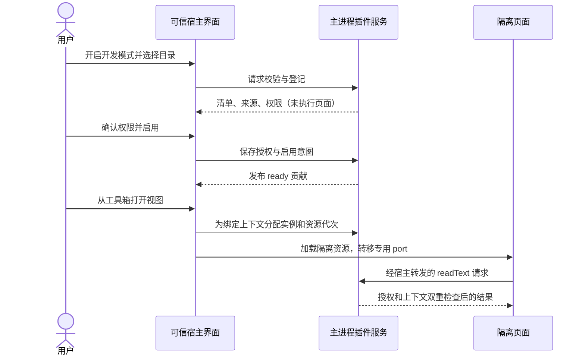
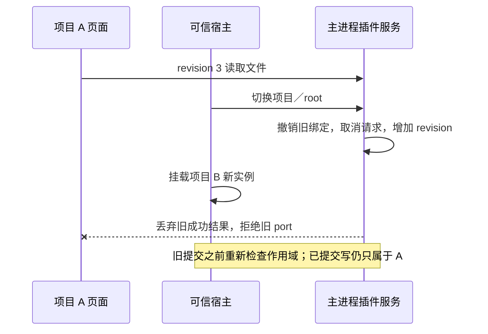

---
{
  "schema": "harness-note/2",
  "id": "144067d8-ab32-445a-bef0-d5e0c2075cc3",
  "kind": "note",
  "lifecycle": "draft",
  "created": "2026-10-22",
  "updated": "2026-10-23T07:51:04Z",
  "class": "architecture",
  "module": "note://972afef3-2fc7-49de-a3ee-7e041225d28c/19cd1394-b2cb-4819-8fde-5f12de16574c",
  "relations": [
    { "type": "related-to", "target": "note://972afef3-2fc7-49de-a3ee-7e041225d28c/43efa5a7-e16c-4cc7-846b-f271f8366260" },
    { "type": "related-to", "target": "note://972afef3-2fc7-49de-a3ee-7e041225d28c/96a2f5cd-166e-4982-a444-7640858f0a5f" },
    { "type": "related-to", "target": "note://972afef3-2fc7-49de-a3ee-7e041225d28c/80e8b427-d263-42f4-b7cd-8313548c9e2a" },
    { "type": "related-to", "target": "note://972afef3-2fc7-49de-a3ee-7e041225d28c/607e1d4b-8bf4-43c7-af1f-97da9ae9e30b" }
  ]
}
---

# 首版本地插件契约

## 状态与适用范围

本文维护首版协议基线及实现边界。`packages/plugin-sdk/` 提供类型、严格清单／调用策略校验、MessagePort 客户端和独立脚手架；命令与入口通过可信适配接入现有视图宿主。P2 已实现目录登记、授权、隔离资源、通信桥、私有 KV 与管理调试界面，P3 增加工作台与 Island 贡献，实际验收及未覆盖项归阶段计划。schema／API 的 `1` 是插件协议版本，不是 JanusX 版本。后续如修改本基线，先记录兼容影响并同步样例和需求。

目标架构归[插件平台设计](plugin-platform-design.md)，验收归[架构需求](requirements/plugin-architecture-forms.md)和[导入需求](requirements/plugin-import-debug.md)，顺序及实施证据归[阶段计划](../planning/plugin-platform-roadmap.md)。全部未来能力不塞进首版 schema；示例只验证契约关系，不指定要交付哪项示范产品。

首版支持中部／右侧／工作台／Island 隔离页面、声明式打开视图命令、工具箱／中部添加菜单／应用内快捷键、项目上下文、指定文件只读、插件 KV、提示和私有存储变更订阅。P3 增加工作台根视图、返回原界面和宿主绘制的 Island 状态／进度／徽标／动作及文本预览。P4 首片增加嵌入文件编辑器的只读 viewer 匹配、默认选择、失败回退及按文档绑定的隔离实例，具体契约见下节；普通 pane 仍为每作用域单实例。文件写入、目录遍历、任意后台 JS、页面直连网络、模型、任意宿主命令、跨插件服务、全局快捷键和通用多实例 pane 暂不支持，传入这些贡献或权限明确拒绝。P4 后续已支持版本化草稿交接、宿主审阅保存和写前冲突检查；持续编辑会话、原子事务与完整冲突验收仍待续。

## 现有消费者与兼容改造

下表保留 P0 的消费者基线；P1 与 P2 的实际实现边界见末节和阶段计划，表内未来语义不替代执行证据。

| 消费者 | 当前事实 | P1／P2 改造与保留 |
|---|---|---|
| [定义](../../../src/renderer/src/extensions/types.ts)、[注册表](../../../src/renderer/src/extensions/registry.ts) | 组件、图标组件和同步 activate；注册即 enable，disable／unregister 发布视图变更 | 可信 API 保留；新增可序列化清单和主进程安装记录；先授权再由可信适配器注册壳组件，不能把异步激活放入同步函数 |
| [启动](../../../src/renderer/src/main.tsx)、[内置定义](../../../src/renderer/src/extensions/builtins.tsx)、[右侧注册表](../../../src/renderer/src/right-tools/registry.ts)、[CPA](../../../src/renderer/src/extensions/cpa.tsx) | CPA 在 renderer 入口注册，内置面板通过右侧元数据模块先注册，包含懒加载和兼容 ID | 保持初始化先后与按需组件加载，不能引入 registry→store→组件循环；保留 `janusx.*`、旧 files／git／sessions ID 和 CPA 停用清理 |
| [视图宿主](../../../src/renderer/src/extensions/ExtensionViewHost.tsx)、[右侧宿主](../../../src/renderer/src/components/right-tools/RightToolHost.tsx)、[终端区](../../../src/renderer/src/components/TerminalArea.tsx) | 可信组件按 active 和 scope 渲染，项目级重挂载，使用现有局部错误边界 | 隔离壳接收实例与上下文，只使用插件桥；普通组件错误与隔离页面超时分别处理，关闭页面不结束宿主 PTY |
| [工具箱](../../../src/renderer/src/components/TitlebarToolGroup.tsx)、[打开路由](../../../src/renderer/src/extensions/workbench.ts) | 工具箱筛选 `launcher: tool-menu`，打开路由直接写两个 store | P1 增加命令与入口 registry；旧 launcher 转为内部命令适配，最终仍走现有打开与 reveal 语义，不出现重复入口 |
| [pane 模型](../../../src/renderer/src/lib/workspace-pane.ts)、[工作区](../../../src/renderer/src/stores/workspace.ts)、[全局工具](../../../src/renderer/src/stores/global-tools.ts) | pane ID 含 view／project，两个 store 订阅 registry，停用时清理活动树与历史项目快照；布局目前为内存状态 | 保留旧 ID，外部实例另加不透明 root／代次映射；P2 只持久化插件设置和私有数据，不把全工作区布局磁盘化捆入首版 |
| [右侧状态](../../../src/renderer/src/stores/right-tools.ts) | 持久化宽度等偏好，启动强制 rail-only，不恢复打开集合 | 保留此策略；插件启用恢复与面板自动打开分开，不因恢复启用而展开右栏 |
| [工作台切换](../../../src/renderer/src/components/WorkbenchSwitcher.tsx)、[应用状态](../../../src/renderer/src/stores/app.ts)、[Island 类型](../../../src/renderer/src/components/janus/janusIslandTypes.ts) | 蓝图／知识库、monitor／chat／roundtable 为固定分支 | P0 记录 P3 替换点，P1／P2 不更改这些分支或自称支持新贡献 |
| [主进程 IPC](../../../src/main/ipc/register.ts)、[preload](../../../src/preload/index.ts)、[文件 handler](../../../src/main/ipc/file-handlers.ts) | 分领域注册，preload 暴露广泛 `window.electron`，文件接口供可信 renderer 使用 | 新建受限插件 broker，禁止通用 IPC 透传及借用可信 renderer 的调用权限；复用底层服务时仍先作插件级校验 |
| [主窗口](../../../src/main/windows/main-window.ts)、[CSP](../../../src/main/bootstrap/session.ts)、[浏览器 guest](../../../src/main/browser/surface-manager.ts) | 主窗口 preload 且 sandbox=false，生产主文档 CSP 限制 frame；浏览器 guest 有独立分区、无 preload 且可联网 | 不把主窗口或浏览器 guest 当作已满足插件隔离；P2 验证专用资源协议／frame／网络限制，保留 Office iframe、CPA 和普通浏览器 |
| [配置服务](../../../src/main/config/service.ts)、[worktree 状态](../../../src/renderer/src/stores/worktree.ts) | 配置位于 userData／janusx，使用串行原子写；活动 worktree 路径是 renderer 状态 | 插件登记／KV 由主进程独立拥有并复用原子写工具；文件根由主进程验证，不能信任页面或 renderer 自报任意路径 |

P1 已新增 `packages/plugin-sdk/`（公开类型、清单／调用校验、模板和工具）、`extensions/commands.ts` 及 `extensions/manifest.ts`。后者只把清单适配为可信组件描述，不安装或执行包资源；P2 先授权再提供隔离壳。`src/main/plugins/`、`src/shared/ipc/plugins.ts` 及 renderer 隔离壳负责登记、资源、桥和布局。管理 preload 接口只给已验证主窗口顶层 frame；插件页面仅接收专用 MessagePort，不能取得 IPC、完整宿主 API 或 `window.electron`。

## 清单字段与合法样例

插件包仅包含 `manifest.json` 和构建后静态资源，不执行 npm、TS 编译、安装脚本或插件 main。首版清单使用严格对象：未知字段、未知权限／贡献、重复 ID 或悬空引用均拒绝，不静默忽略拼写错误。版本字段使用 SemVer；`schemaVersion` 必须为 1，`engines.pluginApi` 按宿主公开 API 版本检查，使用现成 SemVer 实现，不手写版本比较。插件包版本与 API 版本分别处理。

```json
{
  "schemaVersion": 1,
  "id": "example.project-reference",
  "name": "Project reference",
  "version": "0.1.0",
  "engines": { "pluginApi": "^1.0.0" },
  "capabilities": { "required": ["views.workspace", "views.right", "views.workbench", "views.island", "island.status", "commands.openView", "storage.watch"], "optional": [] },
  "permissions": [
    { "name": "workspace.context.read" },
    { "name": "workspace.files.read", "paths": ["README.md", "package.json"] },
    { "name": "plugin.storage" },
    { "name": "ui.views.open" },
    { "name": "ui.toast" },
    { "name": "ui.island" }
  ],
  "contributes": {
    "views": [
      { "id": "details", "title": "Reference", "entry": "dist/index.html", "location": "workspace", "scope": "project", "instancePolicy": "single", "icon": "book", "order": 100 },
      { "id": "summary", "title": "Summary", "entry": "dist/summary.html", "location": "right", "scope": "project", "instancePolicy": "single", "icon": "list", "order": 100 },
      { "id": "desk", "title": "Reference desk", "entry": "dist/index.html", "location": "workbench", "scope": "project", "instancePolicy": "single", "icon": "book", "order": 100 },
      { "id": "island", "title": "Reference tool", "entry": "dist/summary.html", "location": "island", "scope": "project", "instancePolicy": "single", "icon": "list", "order": 100 }
    ],
    "commands": [
      { "id": "open-details", "title": "Open project reference", "action": { "type": "openView", "view": "details" } },
      { "id": "open-summary", "title": "Open reference summary", "action": { "type": "openView", "view": "summary" } },
      { "id": "open-desk", "title": "Open reference desk", "action": { "type": "openView", "view": "desk" } },
      { "id": "open-island", "title": "Open reference tool", "action": { "type": "openView", "view": "island" } }
    ],
    "island": [{ "id": "reference", "title": "Project reference", "scope": "project", "actions": ["open-desk", "open-island", "open-summary"] }],
    "menus": [
      { "location": "toolbox", "command": "open-details", "when": "projectOpen", "order": 100 },
      { "location": "workspace-add", "command": "open-details", "when": "projectOpen", "order": 100 }
    ],
    "keybindings": [
      { "command": "open-details", "key": "Ctrl+Alt+Shift+R", "mac": "Meta+Alt+Shift+R", "when": "projectOpen" }
    ]
  }
}
```

`id` 为 3–128 字符，局部贡献 ID 为 1–64 字符，均匹配 `^[a-z][a-z0-9.-]*$`，禁止末尾点及连续点；第三方不能使用 `janusx.` 前缀。`name`／`title` 为 1–80 非空字符；`description` 为可选、最多 1000 字符。贡献列表可省略为空，但首版至少一个视图，最多 16 个视图、64 条命令、128 个菜单入口、32 条快捷键。局部 ID 在各自贡献类别内唯一；命令引用本插件视图，菜单和快捷键引用本插件命令。不得覆盖内置 ID。`icon` 可省略，首版只支持 `puzzle|book|list|chart|file|code|clock`，缺省为 puzzle；`order` 可省略为 100，取 -1000–1000 整数。排序按用户设置、order、完整贡献 ID，保证稳定。

`location` 仅 `workspace|right|workbench|island`，`scope` 仅 `application|project`，`instancePolicy` 首版仅 `single`。菜单 `location` 仅 `toolbox|workspace-add`。右侧视图自动取得 rail 入口，不需要在菜单中再声明。工作台和 Island 展开工具视图也分别取得宿主入口。`when` 可省略为 `always`，仅 `always|projectOpen` 两个数据枚举，不允许 JS 或自定义表达式。项目视图即使声明 always，缺少项目时仍不可执行；工具箱可以显示为禁用项，workspace-add 无项目时不显示。隐藏某一入口不禁用命令或其它入口。

快捷键为应用内单段组合，不使用 Electron globalShortcut；至少一个 Ctrl／Meta／Alt 修饰键，不使用裸键、Escape、Tab 或宿主保留组合。宿主保留组合优先，用户重绑定其次，插件默认组合最后；同级冲突使这些默认组合都不生效并在管理页报告 `KEYBINDING_CONFLICT`，菜单仍可用。输入框、Monaco、终端及隔离插件页面获得焦点时默认不抢键。首版仅保证宿主非编辑区域焦点下触发，跨隔离页面快捷键转发后置，不监听插件键盘内容。插件不能通过配置覆盖终端快捷键。

`capabilities.required`／`optional` 为无重复短字符串列表。必需能力不支持则 `INCOMPATIBLE_API`；不认识的可选能力可以报告 unsupported，但它不使未知贡献／方法合法。使用某能力的贡献仍需宿主认识。宿主公开能力集为 `views.workspace`、`views.right`、`commands.openView`、`menus.toolbox`、`menus.workspace-add`、`keybindings.local`、`context.project`、`files.readText`、`storage.kv`、`storage.watch`、`ui.toast`、`views.workbench`、`views.island`、`island.status`、`documents.viewers`、`documents.readText`、`documents.applyEdit`、`configuration.settings`、`configuration.open`、`configuration.migrations`、`configuration.customViews`、`tasks.declarative`、`network.fetch`、`credentials.use`、`events.public`、`services.public`。permissions 全部为必需，拒绝任一权限就不激活；可选权限留给后续版本。

## P3 工作台与 Island 契约

P3 是 API 1 的增量，旧清单保持合法。使用新位置的插件将相应能力加入 required，使旧宿主在兼容检查时明确拒绝。视图共用严格清单和原生隔离载体，不新增终端、CLI／会话适配器或 PTY 接口。工作台沿用通用视图 registry，以 location=workbench 筛选；蓝图／知识库 ID、入口和开关保留，不以全量迁移业务为前置。

工作台在主窗口内容区承载一个隔离根页面，插件自行组织内部导航。打开时保留中部和右侧 pane，记录此前工作台；返回按钮恢复此前有效界面和原入口焦点。项目／worktree 改变、停用或贡献撤销时关闭失效工作台；摘要重载可恢复同一有效视图，私有 KV 保留，页面局部状态不保证保留。不创建新原生窗口，不拼装他插件视图。

`contributes.island` 最多四项，每项包含 id、title、scope、可选 order 和至多三个本插件命令 ID 的 actions；重复 ID、悬空引用或不同作用域动作拒绝。声明需 `ui.island` 权限；动作还要求 `ui.views.open`，目标只能是本插件同 scope 的已声明视图。Island 不接受任意回调、HTML、图片 URL、样式、脚本或宿主命令。点击后主进程再次校验贡献、当前发布实例及 grants，不信任 renderer 自报目标。

`island.update({id,status})` 需要 `ui.island`，返回 `{updated:boolean}`。status 为 null 时清除当前发布者状态，否则包含 title（1–80）、state（idle/running/success/warning/error），可选 description（1–240）、progress（0–100）、badge（1–12）和 preview。preview 仅包含 text（1–500）与最多四条 label（1–40）/value（1–120）文本行。文本拒绝控制符和双向覆盖符，以 React 文本绘制；更新不执行后台任务，也不获得额外文件权限。

状态由主进程按 plugin/id 保存最新值并绑定发布页面，publisher 与贡献必须同 scope。另一页面可成为新发布者，但旧页面不能清除新发布者状态，关闭旧页也不删除新状态。关闭当前发布页、故障、重载、停用、删除数据和项目根撤销立即删除所属状态，宿主重启不恢复。每插件最多十次更新/秒，全局最多 32 条，100ms 合并一次界面通知；超限返回 RATE_LIMITED。状态不是通知历史，关闭页面后需重新发布。

Island 胶囊显示状态数量与受限文本，最多三项紧凑展示，完整队列在展开托盘。内置通知排在插件通知前，插件状态不自动升起展开横幅或抢焦点。展开工具页按 location=island 注册，选中并展开后才挂载，收起销毁；项目根变化或贡献撤销退回 monitor。托盘打开时 detach 原生页，使状态动作可见。宿主审批、设置、菜单和权限提示持有遮挡租约时，插件外壳及原生页同时隐藏，释放后恢复。

`views.open` 同时支持 workbench 与 island，仍返回真实实例 ID。外部脚手架只依赖打包 SDK，复用两份 HTML 贡献四个页面，通过 storage.watch 联动同 project/root 的 KV。完整测试证据归阶段计划。

## P4 只读文档查看器

公开能力新增 `documents.viewers`、`documents.readText`，viewer 包必须将两者列入 required，以便旧宿主明确拒绝；新增权限 `documents.read`。原四区域模板和既有清单仍合法，SDK 模板页面已能处理文档绑定；作者按 SDK README 显式添加 viewer 声明，不自动扩大既有示例权限。`contributes.viewers` 最多 16 项，每项包含独立 id、title、引用的 view、extensions 和 filenames；必须有至少一个选择条件。view 只能引用本插件 project/workspace 页面。扩展名以点开头、使用小写后缀，文件名无目录，匹配不区分大小写，不支持 glob；敏感路径和越界路径不匹配。viewer 声明进入授权指纹，改变选择规则需重新确认。

主窗口嵌入文件编辑器提供“打开方式”，默认仍为内置查看器；用户可按扩展名、或无扩展名文件的完整名称保存默认，并恢复内置默认。选择记入各文件的 FileViewState，偏好独立保存在 window localStorage；写入失败明确报告，不伪装保存成功。已停用、未授权项目、开发模式关闭或不再匹配的 viewer 不成为候选。浮窗、Office／二进制、diff／定位导航使用内置路径；未保存文件禁止切换并保留原缓冲。

文档实例逻辑键为 plugin＋view＋project/root＋viewer＋规范化相对 path；相同绑定不重复挂载，不同文件可以同时拥有隔离页，普通视图实例与文档实例分别计数。Windows 同路径大小写不创建重复实例。沿用每插件 8 页和全局 64 页预算。宿主在挂载前验证匹配、项目授权、真实路径、敏感目录、UTF-8 和 1 MiB 上限，异步校验后重查上下文及激活代次；重载或项目切换期间未完成的挂载不能复活旧页。

文档页 context 额外包含 `document:{viewer,path}`，`documents.readText()` 只接受空参数并返回 `{path,text,bytes,version}`；version 是当前内容 SHA-256，不是保存令牌。普通视图不能借此方法读取文档，文档页不能通过它改选其它文件；额外的 workspace.readText 仍独立检查精确路径授权。读取观察磁盘当前内容，不自动推送文件变化；插件需要主动重读，用户可重开或刷新文件。KV 仍按插件/project/root 共享，不因文档实例增多而改变业务存储作用域。

文档页使用原生隔离壳与宿主遮挡租约；挂载失败、页面失效／崩溃或插件停用后回退内置查看器。插件内部业务错误仍由插件展示，不假定可以识别任意脚本错误。只读插件显示期间，宿主保存按钮和 Ctrl/Cmd+S 写入关闭，避免把旧的干净缓冲覆盖到外部更新；关页、切换、停用不写磁盘，未保存缓冲保留。版本化草稿交接和写前冲突检查见下节；自动变更通知、完整文档事务、目录查询、通用多实例 pane 和代表内置查看器迁移尚未实施，架构 AC-10／AC-12 不因此整条关闭。

## P4 文档草稿交接与审阅保存

新增独立权限 `documents.edit` 和必需能力 `documents.applyEdit`；清单必须已有合法 viewer／read 权限，新增权限触发重新授权。旧清单继续只读，旧宿主拒绝新必需能力。主进程为获准的文档上下文附加 `editable:true`，不接受页面自行声明可编辑。仓库外打包 SDK 的模板据此提供文本区与“Send draft for review”，原四区域模板清单不自动扩大权限。

`documents.applyEdit({text,expectedVersion})` 仅作用于宿主已绑定文件，不接收 path。文本为完整替换草稿，UTF-8 最多 1 MiB、无 NUL，expectedVersion 为最近读取的 SHA-256。主进程重新读取并检查磁盘版本和生命周期，向对应可信外壳交付请求；宿主只接收同一工作区已加载、无错误、干净且内容与基线一致的缓冲。两次竞争提交仅第一份能接管，脏宿主缓冲和过期磁盘返回 DOCUMENT_CONFLICT。可信主窗口通过实例／binding／editId 确认，其他页面不能确认；四秒未确认超时，关闭／撤销清理待交接请求。

成功 `{applied:true}` 表示宿主接管未保存草稿，不表示文件保存。交接后插件页保留一个“在内置编辑器审阅草稿”入口；这一片是一份草稿的交接，继续编辑／保存需在内置编辑器完成，不提供长驻插件编辑会话。documents.readText 仍读取磁盘，不读取草稿。已接管内容及 saveVersion 保存在既有 OpenFile／EditorSession，停用、崩溃回退、切项目和整体浮窗迁移保留；关闭沿用保存／放弃／取消对话框，保存失败不关页。对话框持有原生页遮挡租约。页面文本区尚未提交的编辑仍属于页面，重载可能丢失；本片不承诺应用崩溃／重启恢复。取消或确认丢失不回滚已接管草稿，客户端应检查宿主界面。

用户在内置编辑器触发保存时沿用 renderer-user 写入策略授权。带 saveVersion 的保存先以真实文件读取校验基线，再调用既有 WorkspaceFS 写入；同进程编辑器保存共用队列，竞争基线只有第一项成功，新版本随成功结果推进，包括保存期间继续编辑和切至后台的会话。外部修改／文件删除／链接替换阻止保存，保留草稿和原基线，显示可复制草稿后重开文件的处理提示；不提供强制覆盖和合并界面。外部进程不共享队列，校验与写入之间仍有竞争窗口，因此这是写前版本检查，不是操作系统原子 CAS、完整文档事务或 AC-12 全部通过。重读干净文件清除旧草稿基线；原内置文件无 saveVersion 时保持既有保存行为。

后续 P4 需补持续插件编辑会话、跨外部进程的事务边界／冲突合并、自动变更通知、目录查询及代表内置查看器迁移。当前选择复用宿主缓冲和保存流程，避免再建一套独立脏状态；若需要页面内持续编辑与保存，则应升级宿主文档服务而非绕过版本检查。

## P4a 插件参数配置

已实现声明式设置基础版。清单 `contributes.settings` 为 1–64 个字段，需必需能力 `configuration.settings` 和独立权限 `configuration.read`；旧清单不增加字段或权限，旧宿主拒绝新必需能力。字段包含唯一 key、title、可选 description、type、合法 default 与 scope。key 为小写字母起始的字母／数字／点／横线，拒绝原型保留名。type 支持 boolean、string（minLength/maxLength，最多 4096 字符，无 NUL）、number（有限数字、minimum/maximum、可选 integer）与 enum（1–32 个唯一字符串选项）；默认值必须满足约束，不支持任意 JSON Schema、正则、脚本或凭证字段。

scope=application 的字段仅能设置应用值；scope=project 允许在应用默认上按 project＋真实 root 覆盖，不是只在项目存储。主窗口“设置 → 插件 → 参数配置”生成表单，显示当前作用域、显式／继承值、应用级字段限制、校验及保存错误。用户可逐项使用继承值、重置整个当前作用域或重新读取；项目选择限定当前已授权项目／已验证 worktree，应用设置无需开启插件页面即可修改。原生插件页继续服从设置面遮挡，插件文本均由 React 转义，不执行清单 HTML。

主进程配置与私有 KV 分目录保存，复用 PluginStorage 的串行暂存／rename、配额和错误处理，不允许页面伪造 pluginId、projectId 或磁盘根。有效值依次为声明默认→合法应用值→合法项目覆盖。`configuration.get()` 返回 `{values,overrides,inherited,revision,issues}`；overrides 只含本层合法显式值，inherited 在应用层为声明默认，在项目层为有效应用值。issues 仅包含不兼容字段名。未知字段、升级后不合法的旧值或被收紧为应用级的项目值保留在磁盘，参与诊断而不进入有效值；整个文件损坏则 STORAGE_UNAVAILABLE，不自动重置。恢复默认是显式删除本层覆盖，停用／卸载保留配置，“删除插件数据”同时清除 KV 与配置。

读取与 `configuration.watch(listener)` 均需 configuration.read，绑定页面自身插件与 application/project-root，不接收选择参数。watch 返回初始 configuration 和 unsubscribe；主进程将初始快照／订阅与写入放在同一队列，SDK 将早到事件折入返回快照，后续发送完整有效配置。应用值变化通知本插件全部活动配置订阅，项目值变化只通知同一根的订阅；项目覆盖继续优先，切项目／停用／重载撤销旧订阅。沿用每页 64 订阅和既有调用限额，模板仅在 context.configuration=true 时显示并订阅参数。

写入仅通过可信主窗口管理请求，普通页面没有 configuration.set。写入按字段白名单和作用域校验，修改与重置携带 expectedRevision；revision 哈希包含插件／根身份、字段声明、应用与本层修订，父层变化、模式升级和竞争写入使旧表单报 CONFIGURATION_CONFLICT。表单保留待提交值并提供重新读取入口，不用错误覆盖新配置。写前复查安装记录、包 digest、激活代次及项目上下文，迟到请求不能写入撤销后的范围。成功提交与后续通知仍是异步边界，若写入已完成而页面关闭，不承诺撤回已提交配置。

配置导航已接通宿主外壳按钮和 `api.configuration.open(options?)`。SDK 导航需必需能力 `configuration.open`、已声明设置及 configuration.read，旧宿主在清单兼容检查时拒绝新必需能力。host context.configurationNavigation=true 时模板提供配置按钮，作者也可在页面自身菜单调用。请求参数为空，pluginId 与应用／项目作用域由实例绑定推导；项目页打开当前项目／worktree 配置，应用页打开应用默认。仅 active 页面可请求，每插件跨页面 10 秒最多一次；隐藏页返回 CONTEXT_UNAVAILABLE，频繁请求返回 RATE_LIMITED，撤销仍按实例身份拒绝。返回 opened=true 仅表示已派发宿主导航，不表示用户保存。可信外壳按钮无需插件新增权限。设置窗口切到插件页，展开并滚动定位自身表单，沿用原生页遮挡与关闭恢复；普通页面不能指定他插件、路径或任意设置页，不增加通用命令回调类型。

声明式字段迁移已实现。清单 `contributes.settingMigrations` 为 1–64 个 `{from,to}`，需 settings 与必需能力 configuration.migrations；源／目标分别唯一，源必须为退役 key，目标必须是当前字段，拒绝在用源、链式迁移、合并、脚本及转换代码。可信配置管理响应补充当前层的迁移预览，仅包含 from／to 和 ready／occupied／incompatible 状态，不返回不兼容原始值；公开 SDK 的配置读取与订阅格式不变。用户在表单审阅后点击“应用兼容迁移”，主窗口管理请求 configurationUpdate 携带 migrate=true、空 patch、reset=false 及 expectedRevision，不可与普通修改／重置混用。主进程在同一配置队列重新检查预览，只将当前层合法旧值移到尚未保存的目标并删除成功迁移的源，已有目标（包括非法值）、不兼容旧值及无关字段保留。一次原子写入提交全部 ready 项并沿用配置订阅通知；没有可迁移项则拒绝。版本哈希包含映射声明及父层修订，模式变化与并发写入不能沿用旧预览。

迁移不自动执行、不跨层复制或提升项目值为应用值，应用默认与各项目／worktree 分别操作。待提交编辑存在时禁用迁移按钮，先保存或重读；存储损坏或写前身份失效继续拒绝覆盖。此片只支持字段重命名，不提供类型转换、历史备份或迁移回滚；成功移动会消费旧 key，若未来需要包降级保留旧格式或复杂模式转换，需另定版本历史及恢复契约。普通插件没有 configuration.migrate／setter，迁移声明不扩大文件、网络或执行授权。

隔离自定义设置页已接通工作台载体。清单 `contributes.configurationViews` 可声明 application／project 中的一项或两项，值引用同插件、同作用域且 location=workbench 的已有视图；需 settings、必需能力 configuration.customViews 和独立必需权限 configuration.propose。不能声明远程入口、任意宿主组件或与作用域不符的位置。该权限及视图绑定纳入授权指纹，新增或重绑需重新授权；不声明自定义页的既有授权指纹保持兼容。配置表单按当前层显示“打开自定义设置”，进入工作台并关闭设置窗口；宿主普通表单始终可达，现有工作台返回／故障重试、上下文撤销和原生页遮挡规则继续适用，不在设置弹窗上穿透绘制原生页。

主进程仅为声明中的页面设置 context.configurationEditor=true。`configuration.propose({patch,expectedRevision})` 接受 1–64 个声明字段的非敏感值或 null（恢复继承），沿用字段类型／范围／项目限制，不接受插件、项目、路径或其他调用目标。只有活动且已授权的配置页能调用，与 configuration.open 共用每插件 10 秒一次的导航预算；普通页面即使同属该插件也不能提出修改。主进程与读取／写入同队列校验修订和生命周期，随后把建议值交给自身宿主表单；`{proposed:true}` 仅表示导航已派发，不表示写入或用户同意。

宿主展开对应表单、显示建议来源及待审阅字段，用户可修改后保存或重新读取以放弃。父层／本层在交接后被竞争修改时，保存继续使用交接修订，报 CONFIGURATION_CONFLICT 并保留编辑，不能用较新的读取结果自动覆盖修订。切项目／根或模式变化清除旧表单目标，重新读取不会重复灌入同一建议。待提交修改阻止再次进入自定义页；已交接草稿属于当前设置表单，关窗丢弃，不保证重启恢复，尚未交接的页面局部编辑仍随页面销毁而丢失。提交后的取消、确认丢失不撤回已交接内容，普通页面仍没有直接 setter。SDK 外部模板提供可独立构建的 JSON patch 编辑／重读与交接示例，作者可替换成业务表单。

配置不存密钥。P5 已接通独立凭证槽与宿主代用，原始密钥不通过普通配置、日志或插件 UI 返回。复杂类型转换和历史恢复尚未实现，P4 仍不关闭。自定义页复用离线工作台和宿主审阅保存，保留一次交接的编辑边界；需要页面内连续保存或设置内嵌原生页时应另定确认与遮挡契约。

## P5 后台任务、网络与公开协作

P5 采用宿主声明式任务，不加载后台插件 JS。`scripts/probe-plugin-background.mjs` 在 Node 权限模式下验证文件拒绝而网络与环境仍可直通，因此不能把普通子进程作为本契约的权限沙箱。清单 `main`、`background`、执行脚本或任意 exec 步骤仍拒绝。无页面包可只包含 manifest.json，声明空 views 和至少一个 tasks；包管理不加载此类包中的 dist。可独立导入的提供者／消费者示例在 `packages/plugin-sdk/examples/`。

`contributes.tasks` 最多 16 项，需必需能力 tasks.declarative 与权限 tasks.run；每项有 id、title、application/project scope、input、timeoutMs 和 1–32 个 steps。input 是最多 32 个字段的扁平 string/number/boolean 类型映射，调用必须恰好满足字段与类型；字符串最多 4096 字符。步骤限 delay、静态 log、request、emit 和 service，无文件写入、Shell、任意代码或自动定时调度。request 可将 input 作为 JSON POST，emit 可按声明使用 input；service 只调用已声明消费的公开任务。全任务及服务链最多 128 步、8 层，重复 plugin/task 链拒绝 CYCLE_DETECTED。任务超时 10–60000ms；子服务同时检查自身截止时间与根任务取消。

用户在“设置 → 插件 → 后台任务与凭证”输入任务参数并显式运行，也可由获权页面 tasks.start 发起。任务归发起插件及 application/project＋真实 worktree 根，关闭设置或页面不结束任务；切项目／worktree 撤销项目任务，应用任务继续。停用、重载、卸载、关闭开发模式、应用退出及参与服务提供者撤销均停止相关任务，不接收迟到结果。任务可查看状态、静态日志、结果和错误码；用户停止后可重新运行以显式重试，无自动重试／重启恢复。运行记录仅保留本次进程，全局最多 128 条、每插件 32 条；并发全局 16、同一插件参与的并发最多 4，每插件每分钟最多发起 20 个任务。每次运行日志最多 100 条、响应正文合计最多 64 KiB、结果最多 32 项。停止只能取消未完成工作，不能撤销已发出的远端副作用。

`network.fetch` 必需能力及同名权限声明最多 16 个精确 HTTPS origin，不支持通配符、IP 字面量、非 443 端口或用户名密码。SDK network.fetch 和任务 request 均走主进程同一代理，页面 Session 保持离线／原 CSP，不开放 fetch、WebSocket 或 Node 直通。仅 GET／POST，POST 正文最多 32 KiB，不接受任意头、Cookie、客户端证书或传输选项。每跳重新检查 origin、DNS 和生命周期；仅支持公开 IPv4，混合私网／保留地址也拒绝，连接固定到已验证地址并保持原域名的 TLS／证书检查。最多 3 次同源 GET 重定向，跨 origin、POST 重定向、私网和未授权目标拒绝。请求 4 秒超时、每插件同时最多 2／每分钟 20 次、全局同时 16；正文最多 64 KiB，无自动重试。传输使用宿主独立 HTTPS 连接，不继承浏览器 Cookie、系统登录态或环境代理；显式代理、IPv6-only 服务、流式传输和其他认证方案另定增量。

`contributes.credentials` 最多 16 个 `{id,title,origin}`，需 credentials.use 必需能力和权限，origin 必须在网络授权内。宿主输入 Bearer Token，按插件／application 或 project-root／slot／origin 独立加密落盘，不做项目层向应用层的隐式继承。safeStorage 不可用或 Linux 使用 basic_text 时拒绝保存／解密；读取只交付 configured 布尔值，没有 SDK 凭证 getter。替换／撤销前取消相关网络和任务；停用／卸载保留凭证，删除插件数据清除凭证及运行记录。普通配置、KV 和日志不承载凭证。调用只能指定自身已声明槽，同源注入 Authorization；凭证请求仅返回 HTTP status，body 与 contentType 为空，防止服务回显密钥。当前适用于认证动作与连接探测；需要认证响应正文、OAuth 刷新或响应投影时另定防泄漏契约，不将其宣称已支持。

公开事件 `contributes.events` 声明 id、整数 version、scope、data schema 和 consumers 插件白名单。公开服务 `contributes.services` 声明 id、version、task 和 consumers；服务输入为目标任务 input schema，输出固定为宿主 v1 PluginTaskRun 的状态／日志／受限结果，services.call 返回由消费者持有的 run id，可查询／取消。服务运行使用提供者自己的已授权能力；消费者无权读取提供者私有任务或存储。两者分别需要 events.public／services.public 必需能力和权限，消费者还需 consumes.events/services 的 plugin、id、version、schema 和可选 optional。双方版本、schema、范围与白名单须一致；缺少必需提供者阻止启用／调用，optional 不可用时发现降级，不能绕过调用检查。公开服务发现只列出当前实例可消费的匹配服务；不会注册 CLI、终端或任意 IPC。

events.subscribe 返回可撤销订阅，事件携带宿主生成 id、source、version、data 和 trace，只传同一作用域。发布每插件每分钟最多 30 次；每页最多 32、全局 512 个订阅。cause 只能引用 10 秒内本插件实际收到且同 scope 的事件，trace 禁止回到既有插件并限制 8 跳；伪造 cause 拒绝。事件不自动激活任务或调用服务；省略 cause 视为新根事件，仍受发布预算约束，不承诺识别恶意重新发根的语义循环。事件因果记录最多 256 条，关闭页面／停用／重载清理订阅，跨项目清理项目事件。schema 不授予正文、文件或执行权限。新增或变更 P5 贡献参与授权指纹，原先未使用 P5 的授权计算保持兼容。

## 身份与上下文

| 身份 | 格式及来源 | 生命周期 |
|---|---|---|
| pluginId | 清单 ID，经主进程校验 | 安装和数据所有者，不由页面请求选择 |
| viewId／commandId | `extension:<pluginId>/<localId>`／`command:<pluginId>/<localId>` | 稳定贡献身份，兼容现有 view ID |
| projectId | 已登记 workspace 的 ID，作为不透明字符串 | 项目删除后失效，重建项目不自动继承旧授权 |
| rootId | 主进程按 projectId＋已验证真实根目录登记的 UUID | 主目录和每个 worktree 分开，路径不作为公开权限参数 |
| instanceId | 主进程创建的 UUID，普通视图逻辑键为 plugin＋view＋scope；文档页另含 viewer/path | 普通宿主入口重复打开定位原实例；重复挂载请求拒绝；关页再开得到新 UUID |
| generation | 每次加载生成的不可预测运行代次 | reload、context 切换、disable、来源变化全部撤销旧代次 |
| contextRevision | 每次上下文生命周期变更增加的整数 | 请求捕获 revision，返回时再次检查 |

project 视图绑定创建时的 projectId/rootId，主进程验证根属于当前登记项目或已确认 worktree。切项目或切 worktree 时暂停旧上下文，关闭旧桥、取消未完成请求，切回才重新加载并取得新 generation；首次可以直接重挂载，不承诺保留页面局部状态。存储按 projectId/rootId 区分，避免 worktree 串数据。P2 不改变内置面板现有应用级外壳行为。

application 视图始终得到 `project: null`，不能通过文件读取方法窥探当前项目，也不能向 project 视图伪造 rootId。首版 application→project 打开返回 `CONTEXT_UNAVAILABLE`，由用户宿主命令选定项目后打开；project→application 可以打开，但目标仍没有项目能力。上下文只交付 ID、项目名、主题令牌、语言和 active；文件 API 不接收绝对路径、项目 ID 或 rootId，由绑定上下文决定根。插件安装登记不得只信任 renderer 中的 activePaths。

## SDK 方法与权限

插件通过公开 SDK 的 `await connectPlugin()` 获取受限消息客户端；SDK 不创建 `window.janusPlugin` 全局对象，也不注入完整 preload。这是对 P0 尚无消费者的全局注入草案的实现修订，模板已同步采用显式连接。公开异步方法返回 Promise，成功解包结果，失败抛含 `code` 的 PluginError；所有方法支持可选 `{signal: AbortSignal}`，取消不序列化 signal。下表参数是业务参数，不接受 pluginId、generation、磁盘根或任意 IPC channel。

| 方法 | 参数 → 结果 | 必需权限及行为 |
|---|---|---|
| `tasks.start()`／`list()`／`cancel()` | `{task,input}` → `{id}`；自身运行列表；`{id}` → `{cancelled}` | tasks.run；绑定自身作用域，任务脱离页面生命周期，停用／上下文失效取消 |
| `network.fetch()` | `{url,method?,body?,credential?}` → `{status,body,contentType}` | network.fetch；凭证槽另需 credentials.use，认证响应仅返回状态 |
| `events.publish()`／`subscribe()` | `{event,data,cause?}` → `{id}`；`{plugin,event,version}` 与 listener → unsubscribe | events.public；双方声明、schema、版本、作用域、频率及因果链检查 |
| `services.discover()`／`call()` | 可消费描述列表；`{plugin,service,version,input}` → `{id}` | services.public；启动提供者声明任务，运行记录归消费者，沿用任务查询／取消 |
| `app.getInfo()` | `{}` → `{pluginApiVersion, capabilities, locale, theme:{id,tokens}}` | 基础握手信息，无项目或机密；tokens 为宿主公开令牌子集 |
| `workspace.getContext()` | `{}` → `{project:null|{projectId,rootId,name}, revision, active}` | `workspace.context.read`；权限拒绝不泄露项目名 |
| `workspace.readText()` | `{path}` → `{text, bytes}` | `workspace.files.read` 且 path 在声明与授权的精确路径交集；project 作用域，UTF-8 文本最多 1 MiB，二进制／无效编码拒绝，不悄然截断 |
| `configuration.get()` | `{}` → `{values,overrides,inherited,revision,issues}` | `configuration.read`；只读自身绑定作用域的有效非敏感参数 |
| `configuration.open()` | `{}` → `{opened:true}` | `configuration.read` 与必需能力 `configuration.open`；活动页面只请求导航至自身宿主表单 |
| `configuration.propose()` | `{patch,expectedRevision}` → `{proposed:true}` | `configuration.propose`；仅声明的活动配置页，把建议值交给宿主审阅，不直接保存 |
| `configuration.watch()` | 初始 configuration 和 unsubscribe，后续完整有效值快照 | `configuration.read`；与应用继承及本层写入串行订阅，不跨插件／项目根 |
| `documents.readText()` | `{}` → `{path,text,bytes,version}` | `documents.read`；仅宿主已绑定的 viewer 文件，不接收路径；范围、编码和预算见 P4 契约 |
| `documents.applyEdit()` | `{text,expectedVersion}` → `{applied:true}` | `documents.edit`；仅已绑定文档，交接未保存草稿，不直接写入；宿主脏缓冲或磁盘基线不符拒绝 |
| `views.open()` | `{view}` → `{instanceId}` | `ui.views.open`；仅本插件已声明 local view，不允许其它插件、任意 location 或 project 参数 |
| `island.update()` | `{id,status}` → `{updated}` | `ui.island`；仅本插件已声明同 scope 的贡献，文本和配额见 P3 契约 |
| `ui.showToast()` | `{message,level?:info|warning|error}` → `{shown}` | `ui.toast`，消息最多 500 字，显示插件来源，不渲染 HTML；速率限制时明确报错 |
| `storage.get()` | `{key}` → `{found,value?,revision}` | `plugin.storage`，本插件和当前视图作用域的 KV |
| `storage.set()` | `{key,value,expectedRevision?}` → `{revision}` | `plugin.storage`，只存 JSON；缺少 expectedRevision 为串行最后写入，有值时作 CAS，冲突拒绝 |
| `storage.delete()` | `{key,expectedRevision?}` → `{revision}` | `plugin.storage`，删除不存在项幂等，保留单调修订避免 ABA |
| `storage.watch()` | `{keys}` → 初始快照和带 revision 的变更事件，返回 unsubscribe | `plugin.storage`；仅本插件同 scope，1–32 个显式 key，不是公共总线；SDK 注册监听后再返回原子快照／订阅序列，不丢初始化间隙事件 |
| `context.subscribe()` | 监听 active／locale／theme／上下文失效，返回 unsubscribe | 基础事件只含非项目元数据；项目字段需要 context.read；撤销先阻断旧操作，事件只是通知 |

清单里的 `openView` 命令由宿主处理，只定位声明的自有视图，不需要插件页面先运行，也不会调用任意用户 JS。命令以用户宿主入口触发时无需 ui.views.open 权限；页面主动打开视图仍需该权限。首版不实现任意 commands.execute 或 renderer callback。

权限枚举为 `workspace.context.read`、`workspace.files.read`、`plugin.storage`、`ui.views.open`、`ui.toast`、`ui.island`、`documents.read`。仅 files.read 带 `paths`：1–64 个精确、规范化的相对文件路径，无 glob、目录前缀或符号链接授权；其它权限只允许 name。所有资源权限受用户选择项目范围和当前策略再次约束。宿主按安装记录绑定来源、权限指纹及批准项目；资源另绑定内容摘要和实例代次。开发资源内容变化允许重新校验后热重载，权限指纹变化先阻断并重新确认，不把内容重建误作新授权。

KV key 为 1–128 字符的普通字符串，拒绝空、NUL 及 `__proto__|prototype|constructor`；value 为 JSON 值，单值序列化 UTF-8 最多 64 KiB，每插件每 scope 最多 1 MiB、1024 key。存储失败不发送成功事件，revision 在主进程序列化写中产生，卸载默认保留。project 页不能选择 application 存储；同插件 application／不同 root 的数据不默认共享。多页的摘要／详情可通过同 scope 的 storage.watch 联动。

## 资源、路径和预算

| 项目 | 首版限制 |
|---|---|
| 清单 | UTF-8 JSON，无 BOM 依赖，最多 64 KiB；重复 JSON 键拒绝，不能依赖 JSON.parse 的覆盖行为 |
| 静态包 | 最多 2000 个文件、合计 50 MiB；单 HTML／JS／CSS 资源最多 5 MiB，图片最多 10 MiB；其它类型拒绝，超限不部分安装 |
| 静态类型 | `.html|.js|.mjs|.css|.json|.png|.jpg|.jpeg|.webp|.gif|.ico`；不允许 native／wasm／脚本安装器或 SVG 主动内容 |
| 页面 | 每插件每窗口最多 8 个同时挂载的隔离页面，按需创建；跨 root 的旧页暂停，不保证后台保活 |
| 请求 | 单实例最多 16 个在途、每秒 30 次、封包上限 2 MiB；读文件 10 秒，其它请求 5 秒，宿主上限不可由插件延长 |
| 事件与提示 | KV 事件最多每秒 30 条，允许按 key 合并，带最新 revision；toast 每插件每 10 秒 3 条，最大排队 3 条 |
| 挂载与故障 | 首次 ready 超时 10 秒；连续 3 次加载失败／握手超时／renderer 崩溃自动禁用；握手后仍有就绪页面且连续 30 秒无新故障才清零，关闭最后就绪页或撤销取消恢复计时；拒权／文件不存在不算崩溃 |

插件内部资源路径与 workspace.readText 路径均采用 `/` 分隔相对路径：拒绝空段、`.`、`..`、反斜线、绝对／UNC／盘符、NUL、控制字符、查询／片段及 Windows ADS `:`；拒绝 `%` 编码入口以避免双解码。主进程在读取／安装及每次实际打开前检查真实根、父链、最终文件，不跟随符号链接、junction 或其它 reparse 越界。大小使用有界读而非先 stat 后无限读。Windows 保留设备名和尾随点／空格拒绝；文件列表中大小写碰撞拒绝，避免跨平台不同包语义。

权限路径可位于明确批准的项目范围，但拒绝 `.git` 内部、`.env` 及 `.env.*`、SSH／凭证私有文件和宿主数据目录；若确有读取秘密文件的产品需求，另开敏感文件权限契约，不由普通只读开关放行。硬链接不得成为跟随链接绕过，文件在读前后变更时返回 `RESOURCE_CHANGED`，文件系统并发攻击的强隔离证据需 P2 平台验证，不能靠字符串前缀检查宣称完成。

安装主进程原子登记到 userData／janusx／plugins，独立保存 registry、grants、私有 KV 和来源记录；不让插件改写 config.json。复制包先在 staging 完成校验再提交，失败保留已有安装，重复 pluginId 返回错误而非覆盖。链接开发目录也先构建经校验的只读资源快照；内容变化撤销旧资源代次，重新校验并重载，不直接读取任意正在变动的开发树。

## 桥、资源协议与信任

本地开发模式默认关闭，用户明确选择目录后只安装登记；确认所有首版权限并启用才注册入口，页面按用户打开动作懒加载。开发来源含真实目录引用、链接／复制类型及资源摘要，复制不会升级成正式来源。开发开关与 enabled 意图可持久化，启动时重验来源及权限指纹；关闭开发模式立即撤销当前运行。重新打开模式不自动恢复之前被该动作关闭的启用意图。正常重启仅恢复已允许的入口，默认不重新打开页面。

资源 URL 为 `janusx-plugin://<mountToken>/g/<generation>/<relativePath>`。mountToken 为每实例随机资源能力，由主进程绑定不可由清单选择；仅提供本代次经验证的包静态资源，失效即拒绝。插件间不共用 URL 或目录映射，URL 不暴露项目路径。协议命名与旧草案 `plugin://` 对齐为此专用名称，不直接加载 file／http／https 页面。

P2 载体修订为每页面一个 sandboxed WebContentsView，每插件一个内存 Session，与主窗口、浏览器及 CPA 网络会话隔离。主进程为该 Session 配置 offline、无直连绕过且由宿主持有的拒绝代理、WebRTC `disable_non_proxied_udp`、拒绝全部权限／设备及下载；页面及资源附加不可放宽的 CSP `sandbox allow-scripts`，保持 opaque origin。禁止 connect、远程图片／样式／脚本、frame、worker、object、form 与 base 替换，只允许本 mount 的必要静态资源及受限 data 图片。内联样式可用，脚本不开放 unsafe-eval／inline，SDK 随包构建，无 CDN。

修订原因是 Electron 35／Windows 实测：旧主窗口 iframe 虽拦住 HTTP／图片／导航，WebRTC STUN 仍到达本地 UDP 监听器，3 个包的失败证据见 `artifacts/plugin-p2/network-probe.log`。因此不继续共用主窗口 Session，也不改变主窗口 Office CSP。原生页面的 module 加载仍使用专用协议 CORS 和 MIME；CORS 仅用于实例静态包，不用于项目文件或宿主数据。改动增加原生视图布局与遮挡成本，宿主通过 bounds 控制，菜单／对话框／拖拽／工作台遮挡时 detach。平台升级必须重测 HTTP、WebSocket、STUN／TURN、导航和死循环回收；本轮证据及未覆盖面归阶段计划，不把单个网络样例当作所有通道的证明。

首次原生页面 load 后由主进程向已持有且 URL 匹配的 WebContents 转移专用 MessagePortMain；最小 sandbox preload 只把一次性的 port 转给页面，不暴露 IPC 或宿主对象。SDK 检查消息来自当前自身窗口并完成握手；opaque origin 下不单凭 `event.origin === "null"` 判定身份。页面请求及订阅直接经过该 port 到主进程，可信 renderer 只发管理及布局请求，不转发插件数据。绑定映射 plugin／instance／generation／root／grants；其它窗口及 frame 的管理 IPC 拒绝，消息内自报 pluginId 或 rootId 不参与授权。

链接来源登记时保存 canonical root，恢复、启用和重载在读取清单前再次比较，根被 junction／symlink 指向其它目录时拒绝；首次用户选择目录仍允许解析为其真实根。文件内读另检查链接、句柄身份及前后变化。这些检查不构成所有并发操作系统置换的穷尽证明。

Windows 验收补充真实 worktree 页面撤销及根身份／KV 隔离、经桥读取 junction／hardlink 的拒绝，以及原生文件系统在路径验证后、open 前置换父目录的确定性检查点测试。另以真实打开的文件句柄延迟读取，验证旧读取在新根实例建立后完成仍返回 `INSTANCE_CLOSED`。这些证据分别覆盖桌面桥和文件系统检查点，不表示对所有 OS 并发时序或跨平台已经完成验证。

页面再次 load、进程故障、项目切换、重载或停用时先注销绑定并关闭 port，随后才销毁／重挂载原生页。所有请求在接收和回包前均检查有效绑定与 revision，KV 在 staging 写入后、提交 rename 前最后检查。已开始原子提交的 KV 写不回滚，尚未提交写取消；迟到成功事件不能派到新 scope。

下列是形状样例，requestId 在同一 port 内唯一；SDK 将 AbortSignal 转为同一 port 的 cancel。宿主只取消该 port 所有的 ID，重复 ID 返回 `INVALID_REQUEST`，取消／超时后的响应丢弃。错误消息不含绝对路径、秘密或内部 stack，详细日志归宿主并脱敏。

```json
{
  "protocol": 1,
  "requestId": "read-1",
  "type": "request",
  "method": "workspace.readText",
  "params": { "path": "README.md" },
  "contextRevision": 3
}
```

```json
{
  "protocol": 1,
  "requestId": "read-1",
  "type": "response",
  "ok": false,
  "error": { "code": "STALE_CONTEXT", "message": "The project context has changed." }
}
```

成功 response 为 `{protocol,requestId,type:"response",ok:true,result}`；取消为 `{protocol,type:"cancel",requestId}`；事件为 `{protocol,type:"event",subscriptionId,event,contextRevision,payload}`。订阅建立用请求返回 subscriptionId／快照／游标，SDK 按游标去重与排序；退订由同 port 的 subscriptionId 完成，关 port 时宿主全部释放。context.subscribe 的基础主题／语言事件可在原实例持续，root 变更先发失效通知且旧 port 立即撤销，不等待插件确认。

所有桥方法未知字段拒绝。错误码分为安装校验、权限／范围、上下文、资源和运行五类；稳定 code 用于作者分支处理，message 由宿主本地化。

| 错误组 | 必须支持的 code |
|---|---|
| 包校验（导入 AC-2 的六种坏包） | `MANIFEST_INVALID`、`INCOMPATIBLE_API`、`UNSUPPORTED_PERMISSION`、`INVALID_PACKAGE_PATH`、`PACKAGE_LIMIT_EXCEEDED`、`ENTRY_NOT_FOUND` |
| 安装／来源 | `DUPLICATE_PLUGIN`、`DEVELOPMENT_MODE_REQUIRED`、`SOURCE_UNAVAILABLE`、`RESOURCE_CHANGED`、`PERMISSION_RECONFIRM_REQUIRED` |
| 运行授权 | `PERMISSION_DENIED`、`PATH_NOT_GRANTED`、`SENSITIVE_PATH_DENIED`、`INVALID_SENDER`、`UNKNOWN_METHOD`、`INVALID_REQUEST` |
| 上下文／资源 | `CONTEXT_UNAVAILABLE`、`STALE_CONTEXT`、`INSTANCE_CLOSED`、`PLUGIN_DISABLED`、`FILE_NOT_FOUND`、`NOT_TEXT`、`FILE_TOO_LARGE`、`STORAGE_CONFLICT`、`STORAGE_QUOTA_EXCEEDED`、`STORAGE_UNAVAILABLE` |
| 宿主与交互 | `RATE_LIMITED`、`TIMEOUT`、`CANCELLED`、`VIEW_LOAD_FAILED`、`KEYBINDING_CONFLICT`、`INTERNAL_ERROR` |

## 生命周期与时序

安装状态与运行状态分开：安装记录为 installed／invalid／uninstalled，启用意图为 enabled／disabled，当前运行状态为 blocked／ready／loading／active／error。已登记不意味着已授权，ready 表示入口可用但尚无页面。普通本地静态插件没有必需的外部“连接”状态，管理页显示不适用，不能伪造连接成功。

| 事件 | 状态与资源结果 |
|---|---|
| import | 校验快照后 installed＋disabled，完全不执行 JS；失败不产生半安装记录 |
| authorize／enable | 先验证来源、开发开关、兼容与 grants，成功 ready 并发布贡献；任一权限拒绝保持 disabled |
| open／close | ready→loading→active；单 view 失败提供重试，close 关该实例 port，最后页面关闭回 ready，入口仍在 |
| hide／project change | 同 context 的 hide 只发 active=false，宿主可回收；切根立即撤销旧通道，旧 pane 描述可保留待恢复 |
| disable／development off | 先撤销所有绑定，再取消／释放自有资源、注销贡献、清理活动及历史快照，写 enabled=false；宿主会话／宽度偏好／KV 保留 |
| reload | 验证新快照，撤销旧 generation 后换代；失败 error，不执行半校验内容；权限增加进入 blocked，不带旧授权继续运行 |
| repeated load failure | 连续 3 次失败设置 disabled，记录 reason；用户手动 retryEnable 可清计数重新验证，其它插件继续可用；JS OOM／死循环的可终止性必须另测，不以 React boundary 代替 |
| uninstall | 先 disable，再移除静态包与登记，保留命名空间 KV；删除数据需独立明确操作；重装重新授权，保留数据不继承来源信任 |





## 场景推演与 P1／P2 测试输入

此表是 P0 的规格推演，预期结果是未来实现的验收 oracle。除末节明确运行的现有测试外，不称这些场景已在运行时通过。

| 编号 | 输入／触发 | 预期及追踪 |
|---|---|---|
| C01 | 合法双区域样例，开发模式关闭 | 导入可校验登记，enable 拒绝 DEVELOPMENT_MODE_REQUIRED，无贡献或页面；架构 AC-2 |
| C02 | 用户开启开发模式，选择相同目录并确认全部权限 | ready，打开两个视图，引用完整 ID 稳定，关闭一个不关闭另一个；AC-8 |
| C03 | 两个视图相同 project/root，详情 set，摘要 watch | 已持久化后事件与 revision 一致，重载后 get 保留；AC-10 |
| C04 | A 中发起 read 后切 B／worktree | 旧绑定失效，旧成功不送 B；storage 始终按 A root；AC-10 |
| C05 | application view 调 read 或打开 project view | CONTEXT_UNAVAILABLE，不借用全局活动项目；AC-10 |
| C06 | 同 view 重复打开，再关闭重开 | 重复定位同实例，重开换 instance/generation，旧回包无效 |
| C07 | 隐藏 view，随后宿主回收或切回 | active=false；可重挂载恢复 KV，不承诺局部状态或计时器持续 |
| C08 | 停用、关开发模式、卸载 | 先拒绝请求再清视图／快照，PTY 和用户 KV 保留，重启不自动重启页面；AC-18 |
| C09 | 开发链接清单增加 paths／权限或资源被替换 | 新快照重新校验；权限扩大 blocked＋PERMISSION_RECONFIRM_REQUIRED，旧 token 无效 |
| C10 | 清单 JSON 重复键、额外未知字段或悬空命令 | MANIFEST_INVALID；P1 校验器必须覆盖，不是静默覆盖 |
| C11 | 引擎不匹配／声明未知贡献 | INCOMPATIBLE_API／MANIFEST_INVALID；可选能力未知不激活未知贡献 |
| C12 | 请求 net.fetch 或权限列表含网络／写入 | UNKNOWN_METHOD／UNSUPPORTED_PERMISSION，无出站或部分激活 |
| C13 | 静态 entry 为 ../、盘符、%2e、符号链接或 junction | INVALID_PACKAGE_PATH，实际打开时也检查；导入 AC-6 |
| C14 | 清单超限、包超限、缺少页面 | PACKAGE_LIMIT_EXCEEDED／ENTRY_NOT_FOUND，旧安装保留 |
| C15 | read 未声明路径、秘密路径、根外或二进制 | PATH_NOT_GRANTED／SENSITIVE_PATH_DENIED／INVALID_PACKAGE_PATH／NOT_TEXT，无正文泄漏 |
| C16 | 伪造 pluginId、其它 frame 管理 IPC、旧端口 | INVALID_REQUEST／INVALID_SENDER 或关闭通道，无借权 |
| C17 | 页面 fetch、图片探测、自导航、popup、下载、worker | 原生网络／导航层实际拒绝，不能只观察 JS 报错；P2 Electron 必测 |
| C18 | 新加载协议的 module／CSS／字体外链及主界面 Office frame | 包内支持的 JS／CSS 可载入；字体及远程资源拒绝；既有 Office／CPA／浏览器回归通过 |
| C19 | 文件不存在、读取超限或超时、客户端取消 | 对应错误码；取消只作用于本 port，迟到结果丢弃，崩溃计数不增加 |
| C20 | 两页面同时 CAS 写、磁盘写失败／配额超限 | 一个 CAS 成功，一个 STORAGE_CONFLICT；失败无成功事件，KV 不损坏 |
| C21 | watch 注册和初始快照之间发生写入、重载后旧订阅收到事件 | 通过游标交付恰当顺序、去重；旧订阅已撤销，不收到新数据 |
| C22 | 插件快捷键与宿主／他插件冲突，焦点在终端或隔离页面 | 不抢输入；冲突有诊断，菜单仍能触发 |
| C23 | 连续 3 次 ready 超时，另一个插件正常 | 只自动禁用故障插件；手动重试重新验证，CPU 阻塞／进程故障能力另测 |
| C24 | 复制开发来源、重启、原目录消失、重复 ID | 不提升来源；复制快照无需原目录，链接来源失效 SOURCE_UNAVAILABLE；重复 ID 不覆盖 |

## P0 验证与交接

P0 产出为清单／API 规格、源码消费者表、上下文及生命周期规则、两份时序和 C01–C24 推演。P1 已将样例及相应负例转为 SDK 校验测试；P2 将身份／网络／生命周期场景转为真实 Electron 测试。C01–C24 不因规格或纯策略测试通过而成为运行时证据。

P1 按纯数据类型和严格清单校验 → 命令／入口 registry 与旧 launcher 适配 → 工具箱／应用内快捷键 → 仓库外可构建脚手架 → 校验门禁及兼容回归实施。P2 的专用协议、opaque origin 模块、CSP／导航和发送者绑定已作 Electron 载体试验，并据 STUN 失败修订为独立离线原生页面；实现验证及未覆盖项统一归阶段计划。

P0 静态盘点已覆盖本文列出的消费者，现有可信注册、内置 ID、右侧状态和 pane 逻辑以 `npx vitest run tests/unit/extensions.test.ts tests/unit/builtin-extensions.test.ts tests/unit/right-tool-state.test.ts tests/unit/workspace-pane.test.ts` 验证：4 份、92 项通过。该结果只是兼容基础的现状证据，不证明新桥、持久化或隔离已完成。Notes 与样例机械检查结果在实施计划的 P0 交付记录维护。

## P1 实现与限制

SDK 的 `parsePluginManifest` 使用严格 JSON、重复键检查、Zod 和 SemVer，拒绝未知字段、权限、贡献、非法路径、保留 ID、悬空引用及不兼容必需能力。`validatePluginCall` 校验已声明权限、精确文件路径、自有视图和参数；它是可复用的纯策略，未建立真实发送者、用户 grants、上下文或文件系统边界。`PLUGIN_CAPABILITIES` 同时供兼容校验与已实现的首版 broker 握手；新增 capability 必须先实现对应分派及验收。

可信 `ExtensionDefinition` 可分别声明 commands、menus 和 keybindings。旧 workspace launcher 自动适配为内部打开命令，已有 ID、视图生命周期及右侧入口不变；公开清单没有菜单时不生成隐含 launcher。工具箱与中部添加菜单消费命令入口，快捷键只在宿主非编辑焦点下触发；保留 Ctrl／Meta 常用单键及 Shift 变体、Alt+F4、F1／F5／F11／F12 组合。相同优先级冲突均不执行并返回 `KEYBINDING_CONFLICT` 诊断；用户重绑定优先于插件默认，宿主保留组合始终不可覆盖。

`extensionCommands.setMenuPreference` 和 `setKeybinding` 提供入口显隐／排序及快捷键覆盖，使用独立 localStorage 键持久化，容忍未知 ID 和损坏记录；写入失败不改变当前偏好。P2 管理页已提供这些操作及冲突诊断，隐藏设置与排序按字段合并，恢复默认快捷键清除覆盖。关闭视图不注销命令，停用／注销立即移除命令和入口。

第三方管理页区分登记／启用意图与实时运行：每次快照从当前实例计算页面数、桥已连接数及 SDK 已就绪数；bind、握手与关闭均发布变化。插件主动关闭 port 时将不可用页面记为一次加载故障并撤销；宿主正常关闭先移除 carrier，再关 port，不额外计故障。连接仅指本地专用桥，首版没有外部服务连接。内置工具及必要宿主功能不列入第三方停用列表，共享会话仍由宿主管理；停用插件或清理其 KV 不授予结束宿主会话的权限。

脚手架由已打包 SDK tarball 生成到新目录，不覆盖既有文件，也不要求公开 npm 版本已发布。仓库外项目仅引用公开包；构建生成两份 HTML 及本地资源，以四个视图贡献联动中部、右侧、工作台及 Island，未接桥时显示独立预览状态。`janusx-plugin check` 只检查 manifest 与 dist 静态交付树，不执行页面，不构成安装器或并发文件系统安全证明。实际命令、测试数量和证据归[阶段计划](../planning/plugin-platform-roadmap.md)。
