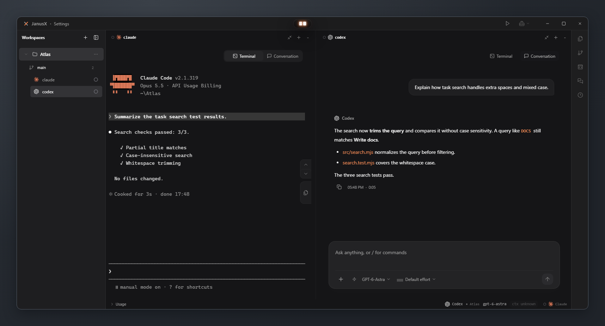
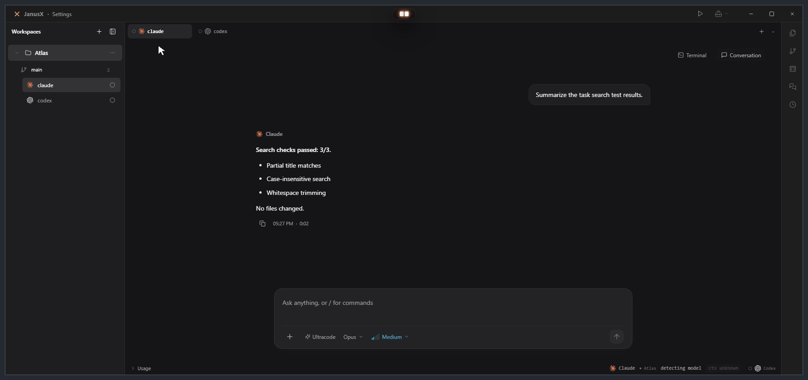
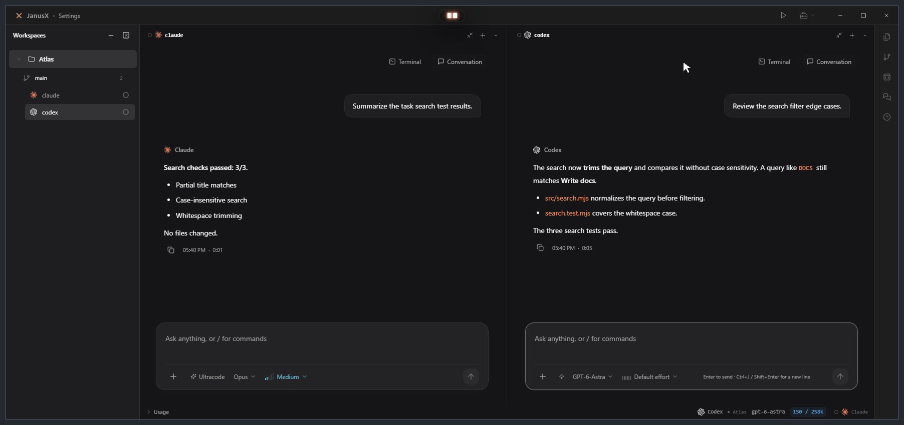
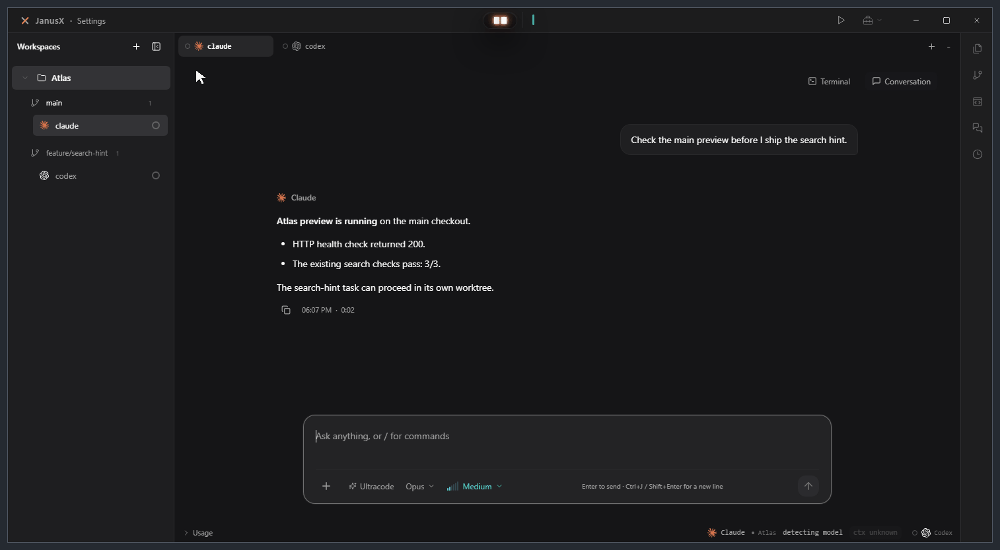
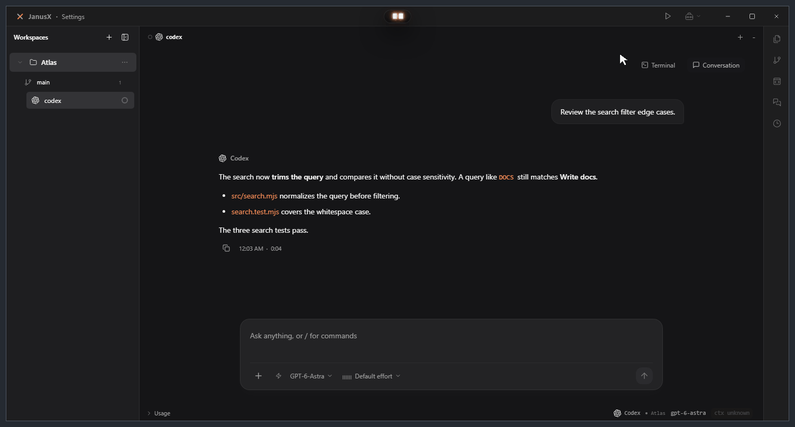
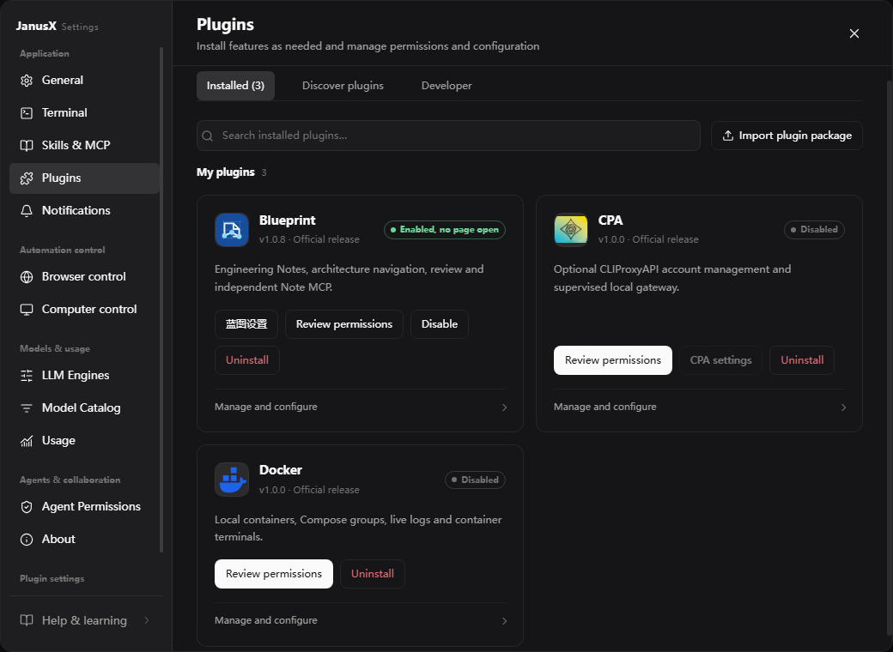
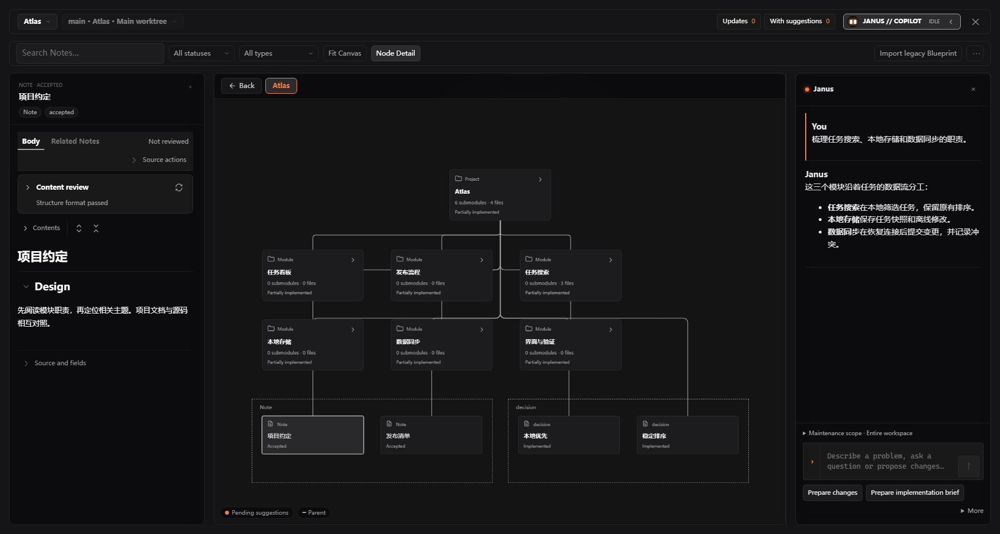

  

  <strong>中文</strong> · <a href="./README.md">English</a>

# JanusX

### 把项目、终端与 AI 编程助手放进同一个桌面工作区

并行管理项目和终端，在同一 CLI 会话里切换终端与对话，并随手查看文件、Git 和会话记录。

[下载安装](https://treex-xx.github.io/JanusX/) · [版本发布](https://github.com/TreeX-xx/JanusX/releases) · [反馈问题](https://github.com/TreeX-xx/JanusX/issues)

  

[安装与开始使用](#安装与开始使用) · [核心体验](#核心体验) · [右侧工作台](#右侧工作台) · [插件](#插件) · [贡献与社区](#贡献与社区)

## 安装与开始使用

前往 **[官方下载页](https://treex-xx.github.io/JanusX/)**，选择 Windows 10 / 11 的 x64 安装包。

| 版本 | 适合场景 | 使用方式 |
| --- | --- | --- |
| 安装版 `*-x64-setup.exe` | 在电脑上日常使用 | 运行安装向导，选择安装目录，完成后启动 JanusX |
| 便携版 `*-x64-portable.exe` | 希望免安装运行 | 下载后直接运行 `.exe` |

便携版的数据位置

免安装版的数据固定保存在当前用户的 `%APPDATA%\JanusX-Portable`，与安装版、开发版隔离；不提供随身模式，也不会在 exe 同目录新建 `data`。复制 exe 到其他电脑不会携带个人数据。

公开下载面向 Windows，安装与使用无需 Node.js 或克隆源码。其他平台的构建说明见[维护者指南](./docs/maintainers.md)。

**三步开始**

1. 添加本地项目作为工作区。
2. 打开 Shell 或已配置的 AI CLI，开始工作。
3. 按需要分屏，打开右侧文件或 Git 面板作对照。

## 核心体验

### 多终端分屏

把 Shell、Claude Code、Codex、OpenCode、Pi 等 CLI 放进同一个工作区。拖动标签创建横向或纵向分屏，调整窗格比例，再把标签合回去。

  

### 同一会话，终端与对话

在支持的 AI CLI 会话中切换终端与对话视图，在终端里直接操作，或在对话里阅读消息、查看文件引用和处理审批。各 CLI 支持的交互有所不同。

  

### 用 Worktree 并行开发

让预览服务留在主分支运行，在独立 Worktree 开发和测试。提交后查看差异，合并回主分支，再切回原会话查看服务。

  

**Island 对话与通知**。从顶部胶囊打开对话，附加项目作为上下文。也可以从通知打开产物，查看报告或交互预览。

**运行配置与用量**。在对话中生成项目运行配置，审核后保存，再测试和启动。用量面板可查看受支持 CLI 的当前明细和历史统计。

## 右侧工作台

右侧图标栏集中呈现日常工具。收起时悬停可以预览，点击后固定面板，在终端旁继续操作。

- **文件**。浏览和搜索项目文件，查看内容及 Git 状态标记。
- **Git 与仓库**。查看工作区改动、提交历史和差异，也可从工作台进入托管仓库侧栏。
- **会话**。搜索历史，查看最近轮次和详情，再从对应入口继续。
- **自动化**。查看任务卡片、执行进度和结果。

  

内置浏览器与 Markdown 位于全局工具区，可用于并排查看网页、项目预览和文稿。

## 插件

按需安装官方插件。下载插件包后，在 **设置 → 插件 → 已安装** 导入，并按提示审阅权限、启用插件。

  

| 插件 | 用途 |
| --- | --- |
| [蓝图](./plugins/blueprint/README.md) | 浏览项目模块与 Notes，通过对话维护项目约定，并按需开启 Git 提交审核。 |
| [CPA](./plugins/cpa/README.md) | 托管本地 CLIProxyAPI 实例，或连接现有实例，在 JanusX 中打开管理页面。 |
| [Docker](./plugins/docker/README.md)（实验） | 管理本地 Docker 容器，查看日志并打开容器终端。 |

[下载官方插件包](https://github.com/TreeX-xx/JanusX/releases/tag/v0.9.8)

  

## 贡献与社区

JanusX 采用 [MIT 许可证](./LICENSE)。欢迎通过 [Issues](https://github.com/TreeX-xx/JanusX/issues) 提交问题和使用场景，或按[贡献指南](./CONTRIBUTING.md) 向 dev 分支提交 PR。

- [本地开发指南](./docs/development.md)覆盖环境准备、同级仓库依赖和验证命令。
- [测试指南](./docs/testing.md)说明各类测试的入口。
- [维护者指南](./docs/maintainers.md)说明打包、发布和恢复流程。

- **邮箱**：[740288105@qq.com](mailto:740288105@qq.com)
- **QQ 交流群**：1125733779（JanusX 交流群一），扫描下方二维码加入。进群反馈问题、交流 Agent 开发、讨论 JanusX 功能，以及得到第一手的更新内容与想法。

  

[Linux.Do](https://linux.do/) · [Star 历史](https://www.star-history.com/#TreeX-xx/JanusX&Date)

[MIT License](./LICENSE) · 自由使用 / 修改 / 再分发 · Made by [@TreeX-X](https://github.com/TreeX-X)

